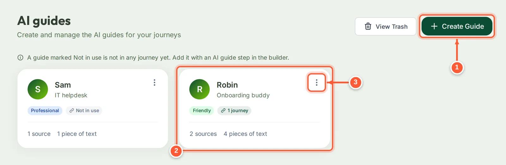

# AI Guides Overview

AI guides are chat assistants that answer questions from participants. A guide answers from the documents and texts you add to its knowledge base.

1. Create Guide: set up a new AI guide.
2. A guide with its role, personality, the journeys that use it and its knowledge (sources and pieces of text). Click it to edit the guide.
3. The menu of a guide: make a copy or delete it.

## Overview

With AI guides you can:

- Let participants ask questions about your content
- Give answers with the sources they come from
- Set the personality and language of each guide
- Add a guide to a journey as an AI guide step, or as the guide in any other step

[[goto:/dashboard/guides]]

## What is an AI Guide?

An AI guide is a chatbot that answers from your own content:

- You upload documents or type texts in its knowledge base.
- When a participant asks a question, Gryffi looks up the pieces of text that fit the question best.
- The guide answers from those pieces of text.
- The answer shows which sources it used.

The guide is not trained on your content. It looks things up every time a question is asked. When you change the knowledge base, the guide uses the new content right away.

See: guide-knowledge-base

## Creating an AI Guide

There are two ways to create an AI guide:

1. **Manually** on the AI guides page, as described below. You set the name, role, personality, knowledge base and extra instructions yourself.
2. **With the Journey Wizard** when you create a new journey. The wizard can create a new guide with a name you choose. It can fill the knowledge base of that guide with the document you uploaded in the first step. It can also add an existing guide to the new journey.

See: journey-wizard

### Step 1: Create a new guide

1. Go to AI guides.
2. Click **Create Guide** (1).
3. Enter a **Name**. This is the only required field.
4. Optional: fill in **Role**, **Personality**, **Greeting Message** and **Extra instructions for the guide**.

To edit an existing guide, click it in the list (2). Its menu (3) lets you make a copy or delete it.

### Step 2: Build the knowledge base

Add the content the guide should know:

- Upload documents (PDF, Word, PowerPoint, text, Markdown, CSV or images)
- Type or paste text with **Add Text**

See: guide-knowledge-base

### Step 3: Identity

In the **Identity** section of the guide's page you set:

- **Name** (for example "Sarah")
- **Role** (for example "HR Assistant")
- **Avatar**: an image that gives the guide a face

### Step 4: Personality

In the **Personality** section you set how the guide talks to participants:

- **Personality Type**: Friendly, Professional, Helpful, Cheerful or Wise
- **Language**: the language the guide answers in. You can choose from 14 languages.
- **Greeting Message**: the first message participants see when they open the chat
- **Extra instructions for the guide**: optional rules for how the guide behaves, for example which topics to focus on, what to avoid, or how to handle certain questions

### Language Settings for AI Guides

**Default behavior:**
- A new guide gets the default language of your organization. You can change it on the page of the guide.
- A guide always answers in its own language, also when someone asks a question in another language.
- The greeting message is shown as you wrote it in the guide settings.

**Different language per journey:**
- Each journey can use a different language for its guide.
- In the journey settings, turn on **Use a different language for the guide**.
- Choose the **Guide language** from the base languages (English, Dutch, German, French, Spanish) or the extended languages (Italian, Portuguese, Danish, Norwegian, Finnish, Swedish, Polish, Romanian, Turkish).
- The guide then writes its greeting and answers in that language.

**Fixed opening sentence:**
When the guide uses a different language, you can also enter a **Fixed opening sentence**:
- The guide starts with this sentence instead of writing its own.
- It shows right away, without waiting for the AI.
- Copy & Translate fills it in for you.
- You can edit it yourself.

See: journey-settings, language-settings, copy-translate

### Step 5: Test the guide

Click **Test this guide** at the top of the guide's page. A panel opens on the right where you chat with the guide, the same way a participant would:
- The panel starts with the greeting participants see.
- The guide answers with the saved settings and knowledge. Changes you just made are saved first.
- Under each answer you see the sources it used.
- Click **Start over** to begin a new conversation.

When a guide gives a wrong answer, check its knowledge base and its extra instructions. Then test again.

## Using AI Guides

### In an AI guide step

1. Add an AI guide step to your journey.
2. Select which AI guide to use.
3. Optional: on the How it works tab, add context for this step.
4. Participants chat with the guide during the journey.

See: guide-step

### In any other step

You can also add a guide to other steps with **Guide in this step**. Participants can then ask questions about what they see, without leaving the step.

See: step-assistant

## Deleting a Guide

When you delete a guide, it moves to the trash. You can restore it from there. You cannot delete a guide that is used in a journey. Remove it from those journeys first.

See: trash

## Knowledge Base Sources

| Source type | Description |
|-------------|-------------|
| **Documents** | PDF, DOC, DOCX, TXT, MD, CSV, PPTX, images |
| **Text** | Text you type or paste |

## Answer Quality

### Source citations

When an answer uses the knowledge base, a small number appears after the sentence that comes from a source, for example [1]. The sources are listed below the answer. Participants can click a number or a source to read the passage the answer comes from. The test chat in the guide settings shows sources the same way.

### Unknown topics

When the knowledge base has no answer, the guide says it does not know. It suggests asking a colleague or a manager. The guide is told never to make up company information.

## Best Practices

### Knowledge base
- Keep content up to date
- Cover the questions participants ask most
- Check and improve it regularly

### Personality
- Match the way your organization talks
- Do not let the guide pretend to be human
- Tell participants what the guide can and cannot help with

### Maintenance
- Look for questions the guide could not answer
- Add content based on questions from participants
- Test the guide regularly

## Limitations

- The AI can sometimes give a wrong answer
- The guide cannot look things up in other systems
- Facts about your organization only come from the knowledge base. What is not in there, the guide does not know.
- The guide has no access to personal data of participants

## Related Features

- [[goto:/dashboard/guides]] - Manage AI guides
- See: guide-knowledge-base, guide-step, step-assistant, language-settings, journey-settings, copy-translate, journey-wizard
