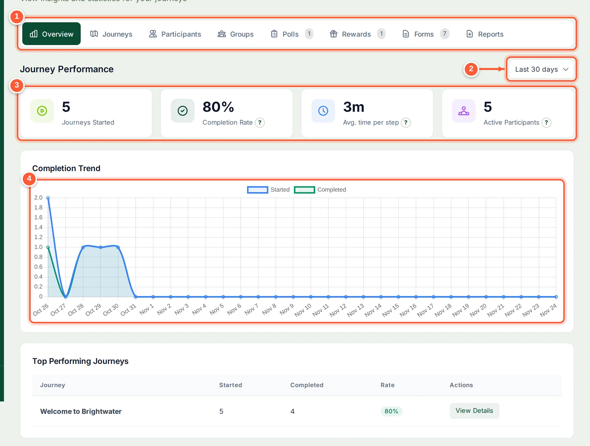

# Analytics Overview

Analytics shows how your journeys perform, how participants progress and what they answered.

1. The tabs: Overview, Journeys, Participants, Groups and Responses.
2. The period the figures are about.
3. Download PDF: a report of what the tab shows.
4. Journeys started, completion rate, average time per step and active participants.

## Who can open Analytics

Every maker role can open Analytics: Admin, Journey Manager, Editor and Viewer. All roles see all tabs, including Forms. Only an admin can delete results (see "Results of deleted journeys and steps" below) and archived polls.

## Overview

The Analytics page has five tabs (1):

| Tab | Description |
|-----|-------------|
| Overview | Key figures and trends of all journeys |
| Journeys | Funnel and step performance of one journey |
| Participants | Progress and activity per participant |
| Groups | Comparison between groups |
| Responses | Poll results, form submissions and rewards |

[[goto:/dashboard/analytics]]

Above the tabs you find:

- **Period** (2): Last 7 days, Last 30 days (default), Last 90 days, Last 365 days or All time. The period applies to Overview, Journeys and Groups, and to their PDF reports. Participants and Responses always show all results.
- **Show deleted**: also show the results of deleted journeys and steps. See "Results of deleted journeys and steps" below.
- **Download PDF** (3): on Overview and Journeys. It makes a report of what the tab shows, for the same period. The report for one participant or one group is in their window.

## Overview Tab

The Overview tab shows key figures (4) for the selected period (2).

### Key figures

| Figure | Description |
|--------|-------------|
| Journeys Started | Journey starts in the period |
| Completion Rate | Of all journeys that participants started in the period, the share they finished. Under it: how many of how many. |
| Avg. time per step | Average time participants spend on a step |
| Active Participants | Different participants who started a journey in the period |

### Started and completed

A sentence says how many journeys were started and completed in the period. The chart below it shows them per day. For longer periods it shows them per week or per month. The dark bar (completed) is drawn inside the light bar (started).

### Top Performing Journeys

A table of journeys, ranked by the number of completions:
- Journey title
- Started
- Completed
- Rate (completion rate)

## Journeys Tab

See how one journey performs, step by step.

[[goto:/dashboard/analytics#journeys]]

1. Select a journey from the dropdown.
2. Choose the period above the tabs.

You then see:
- Started, Completed and the completion rate of the journey
- The **Participant Progression Funnel**: how many participants reached each step, in the order of the journey. Where the journey branches, the steps of each route only count the participants who chose that route. A sub-journey step counts everyone who went through the sub-journey.
- **Step Performance**: a table per step
- **Started and completed**: the same chart as on the Overview tab, for this journey

### Step Performance

| Column | Description |
|--------|-------------|
| Step | The step title |
| Type | The step type, as in the builder |
| Reached | Participants who reached the step |
| Completed | Participants who completed the step |
| Avg. Time | Average time spent on the step |
| Stopped here | Participants who reached the step and did not complete it. The number is red when it is at least 1 in 5 of the participants who reached the step. |

### Download PDF

Click **Download PDF** above the tabs to make a Journey Performance Report of the selected journey, for the selected period. See: reports

## Participants Tab

Follow the progress of each participant.

[[goto:/dashboard/analytics#users]]

Search by name or email, or pick a group in the **All Groups** dropdown.

The table shows:
- Participant name and email
- Groups (a participant can be in more than one group)
- Completed journeys
- Quiz score (average)
- Last activity

On a phone the table shows the name, the completed journeys and the last activity. Groups and quiz score are in the participant's window.

### Participant Details

Click a participant to open their window with:
- Name, email and groups
- Journey Activity: each journey with the number of steps completed
- Quiz Performance: attempts, best score and average score per quiz

Click **Download PDF** in this window for a progress report of the participant.

### Journey Replay

A replay shows a timeline of one journey of one participant:
- Each step visited, with the time spent
- Quiz attempts and scores
- Form submissions
- Video watch progress
- AI guide chats
- Poll votes

To open a replay:
1. Go to Analytics, tab **Participants**.
2. Search for the participant and click them.
3. Click **View Replay** next to the journey.

A replay is available for every journey the participant started, also when they did not finish it. A journey inside another journey counts as completed when the participant finished it there.

## Groups Tab

Compare participant groups.

[[goto:/dashboard/analytics#groups]]

### Group table

| Column | Description |
|--------|-------------|
| Group | The group name |
| Members | Participants in the group |
| Active | Participants with activity in the period |
| Rate | Completion rate of the group |
| Quiz Score | Average quiz score of the group |
| vs Benchmark | How the quiz score of the group compares to the whole organization |

The last row, **Whole organization**, shows the same figures for all participants together. A group where nobody started yet shows "-" instead of a rate.

### Group Details

Click **View Details** on a group to see:
- The number of members
- Active participants and journeys completed
- Quiz statistics: average score, pass rate and total attempts
- Top Performers: the 10 members with the best results

Click **Download PDF** in this window for a progress report of the group, for the selected period.

## Responses Tab

What participants answered and received, with three buttons at the top:

- **Polls**: the results of the Poll steps. See: poll-results
- **Forms**: one table per form, with a row per submission and a column per question. See: form-submissions
- **Rewards**: which reward codes were claimed and how many are left. See: reward-tracking

[[goto:/dashboard/analytics#polls]]

## Period

One period applies to the whole page: Last 7 days, Last 30 days (default), Last 90 days, Last 365 days or All time. It changes the figures on Overview, Journeys and Groups, and the PDF reports. Participants and Responses always show all results; there it says **All results**.

## Results of deleted journeys and steps

Results stay in Analytics when a journey is deleted for good from the trash, or when a step is deleted in the builder. This covers progress, quiz scores, poll votes, form submissions and their files, rewards and video statistics.

Above the tabs there is a checkbox **Show deleted**. It is off by default.

- **Off**: Analytics looks as if the deleted journeys and steps are gone.
- **On**: deleted journeys show in the journey lists and selectors, and deleted steps show in the step lists. Both are marked **Deleted**. The sections **Archived Polls** and **Archived Rewards** on the Responses tab also only show with it on.

With it on, the Overview tab shows the card **Deleted journeys and steps**. It has two lists:
- **Journeys deleted for good**, with the number of participants
- **Deleted steps**, with the journey they were in

Only an admin sees the button **Delete results** in this card. Gryffi asks for confirmation first. The results are then removed for good, uploaded files included. You cannot undo this.

Good to know:
- A journey that is deleted for good cannot be restored. Its results only stay in Analytics.
- A journey without any results is removed completely.
- Undo in the builder brings a deleted step back, with its results.
- When you delete a participant, their results are deleted too.
- Completed and expired invitations, with their progress, are still removed after 1 year.

## Related Features

- [[goto:/dashboard/analytics]] - View analytics dashboard
- See: reports, poll-results, reward-tracking, form-submissions, end-user-management, end-user-groups, trash
