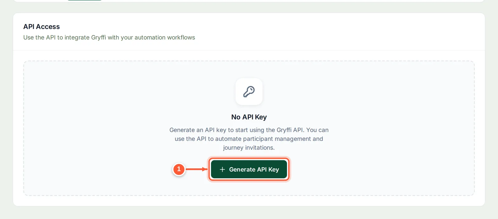

# API Access

With the API, another system can add participants to Gryffi, invite them to a journey and put them in groups. An HR system can, for example, invite every new employee to the onboarding journey on their first day.

1. Generate API Key: create the key for the public API. Gryffi shows it once; store it in a safe place.

## What the API can do

- List the published journeys
- Create and delete participants
- Invite a participant to a journey (Gryffi sends the invitation mail)
- List, create and delete groups, and add or remove group members

The API cannot change journeys and does not give analytics.

## Prerequisites

To use the API, you need:

1. **Admin role** in your organization
2. **API Key** generated on the Organization page with **Generate API Key** (1)

[[goto:/dashboard/system-settings#api]]

An organization has one key. **Regenerate Key** makes a new key and the old one stops working at once. **Revoke Key** removes the key.

## Base URL and authentication

The base URL is your Gryffi address followed by `/api/v1`.

Send the key in the `X-API-Key` header with every request. Send request bodies as JSON with `Content-Type: application/json`.

## Endpoints

| Endpoint | Method | What it does |
|----------|--------|--------------|
| `/journeys` | GET | List the published journeys (id, title, description) |
| `/end-users` | POST | Create a participant. Returns the existing one if the email address is already known |
| `/end-users` | DELETE | Delete a participant by email address |
| `/invitations` | POST | Invite a participant to a published journey. Creates the participant if needed |
| `/groups` | GET | List the groups with their number of members |
| `/groups` | POST | Create a group |
| `/groups/{id}/members` | GET | List the members of a group |
| `/groups/{id}/members` | POST | Add participants to a group by email address |
| `/groups/{id}/members` | DELETE | Remove participants from a group by email address |
| `/groups/{id}` | DELETE | Delete a group. The group must be empty |

## Request Examples

### List Journeys

Get all published journeys to find the journey_id for invitations.

curl -X GET "https://api.gryffi.com/api/v1/journeys" \
  -H "X-API-Key: grf_your_api_key_here"

### Create Participant

Create a new participant in Gryffi. If the email already exists, the existing participant is returned with `"created": false`.

curl -X POST "https://api.gryffi.com/api/v1/end-users" \
  -H "X-API-Key: grf_your_api_key_here" \
  -H "Content-Type: application/json" \
  -d '{
    "email": "john.smith@company.com",
    "first_name": "John",
    "last_name": "Smith"
  }'

### Invite to Journey

Invite a participant to a specific journey. Creates the participant if they don't exist yet. Gryffi sends the invitation mail in the language of the journey, or else the language of your organization.

curl -X POST "https://api.gryffi.com/api/v1/invitations" \
  -H "X-API-Key: grf_your_api_key_here" \
  -H "Content-Type: application/json" \
  -d '{
    "email": "john.smith@company.com",
    "first_name": "John",
    "last_name": "Smith",
    "journey_id": "your-journey-uuid-here",
    "validity_days": 14,
    "max_completions": 1,
    "send_reminder": false
  }'

- `validity_days`: how long the link works: 7, 14 (default), 30 or 90.
- `max_completions`: how often the participant can complete the journey: 1 (default), 2, or -1 for unlimited.
- `send_reminder`: `true` sends a reminder halfway through the validity period. Default `false`.

The answer contains the personal link (`magic_link`), in case you want to send it yourself as well. If the participant already has an open invitation for this journey, the answer is 409 with the id of that invitation.

### Delete Participant

Remove a participant from Gryffi by their email address. This also removes their invitations and progress.

curl -X DELETE "https://api.gryffi.com/api/v1/end-users" \
  -H "X-API-Key: grf_your_api_key_here" \
  -H "Content-Type: application/json" \
  -d '{
    "email": "john.smith@company.com"
  }'

### List Groups

Get all groups in your organization with their member count.

curl -X GET "https://api.gryffi.com/api/v1/groups" \
  -H "X-API-Key: grf_your_api_key_here"

### List Group Members

Get all members of a specific group.

curl -X GET "https://api.gryffi.com/api/v1/groups/your-group-uuid-here/members" \
  -H "X-API-Key: grf_your_api_key_here"

### Create Group

Create a new group to organize participants.

curl -X POST "https://api.gryffi.com/api/v1/groups" \
  -H "X-API-Key: grf_your_api_key_here" \
  -H "Content-Type: application/json" \
  -d '{
    "name": "Marketing Team",
    "description": "Optional description"
  }'

### Add Group Members

Add one or more participants to a group by their email addresses. Send at most 1000 addresses per request. The answer lists which addresses were added, which were already a member and which are not a participant.

curl -X POST "https://api.gryffi.com/api/v1/groups/your-group-uuid-here/members" \
  -H "X-API-Key: grf_your_api_key_here" \
  -H "Content-Type: application/json" \
  -d '{
    "emails": ["john.smith@company.com", "another@example.com"]
  }'

### Remove Group Members

Remove one or more participants from a group by their email addresses.

curl -X DELETE "https://api.gryffi.com/api/v1/groups/your-group-uuid-here/members" \
  -H "X-API-Key: grf_your_api_key_here" \
  -H "Content-Type: application/json" \
  -d '{
    "emails": ["john.smith@company.com"]
  }'

### Delete Group

Delete a group. The group must be empty (no members) before it can be deleted.

curl -X DELETE "https://api.gryffi.com/api/v1/groups/your-group-uuid-here" \
  -H "X-API-Key: grf_your_api_key_here"

## Answers and errors

Every answer is JSON. A successful answer has `"success": true`. An error has `"success": false` with `error` and a `message` that says what to change.

| Status | Meaning |
|--------|---------|
| 200, 201 | Done (201: something new was created) |
| 400 | Something in the request is missing or wrong, for example `validity_days` is 45 or the body is not valid JSON |
| 401 | No key, or the key is wrong or revoked |
| 403 | Your plan does not include the API, or a limit of your plan is reached |
| 404 | The journey, group or participant does not exist in your organization |
| 409 | It already exists: an open invitation, or a group with the same name |
| 429 | Too many requests. Wait and try again |

## Limits

- 5000 requests per 15 minutes per organization.
- After 30 requests with a wrong key in 15 minutes, an IP address is blocked for the rest of those 15 minutes. Requests with a valid key do not count, also when the answer is 404 or 409.

## Best Practices

- Store the API key in a safe place, such as an environment variable, and never in code.
- Retry after a 429 with a growing wait time.
- Check the answer of every request: a 409 for an invitation means the participant already has one.

## Related Features

- [[goto:/dashboard/system-settings#api]] - Manage API keys
- See: api-keys
