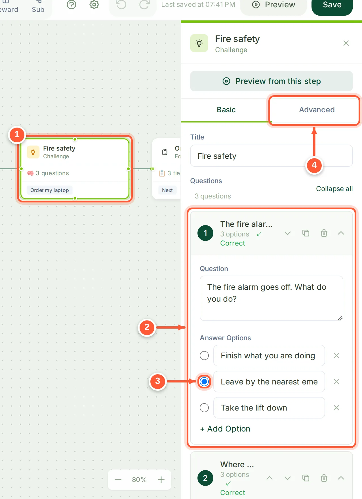

# Quiz Step

The Quiz step asks participants multiple-choice questions to test what they know. Use it for training, checks after a learning module or a bit of fun.

1. The Quiz step on the canvas.
2. A question with its answer options. Click + Add Option for another option.
3. The selected radio button marks the correct answer.
4. How it works: the passing score, feedback and retakes.

## Overview

With a Quiz step you can:

- Ask one or more multiple-choice questions
- Set how many answers must be correct to continue
- Show participants right away if their answer is correct
- Let participants try again when they do not pass

## Properties

### What they see

| Property | Description |
|----------|-------------|
| **Title** | The name of the quiz (for example "Safety check") |
| **Questions** | The questions with their answer options |
| **Randomize question order** | Each participant sees the questions in a different random order. This option shows when the quiz has 2 or more questions. |

### Questions

Each question has:

| Element | Description |
|---------|-------------|
| **Question** | The question text |
| **Answer Options** | 2 to 6 answer options |
| **Correct answer** | One option per question. Click the circle in front of the right answer. |

### Adding questions

Click the Quiz step on the canvas (1) to open its settings.

1. Click **+ Add Question**.
2. Type the question (2).
3. Fill in the answer options. A question starts with 2 options. Click **+ Add Option** for another option, up to 6.
4. Click the circle in front of the right answer (3).
5. Repeat for more questions.

Each question has buttons to move it up or down, duplicate it or remove it. Click a question to fold it open or closed.

## How it works

The quiz settings are on the **How it works** tab (4):

| Setting | Description |
|---------|-------------|
| **Guide in this step** | An AI guide that helps participants while they are on this step |
| **Passing Score** | How many answers must be correct to continue: No requirement (always pass), At least 1, 2, ... correct, or All questions. The default is No requirement. |
| **Show feedback after each answer** | Participants see right away if their answer is correct. On by default. |
| **Allow retake on failure** | Participants can try again if they do not pass. On by default. |
| **Pass Message** | The text participants see when they pass |
| **Fail Message** | The text participants see when they do not pass |

See: quiz-settings, step-assistant

## Tips

### Writing good questions

- Be clear and specific.
- Avoid trick questions.
- Make the wrong answers plausible.
- Test understanding, not memorization.
- Don't use "all of the above" or "none of the above".
- Avoid questions with "not" in them.

### Setting the passing score

The passing score is a number of correct answers. For a safety or compliance quiz, ask for all questions or nearly all. For a quiz just for fun, a lower score or No requirement works fine.

## Use Cases

- **Training check**: test knowledge after a learning module
- **Compliance**: check that participants understood the rules
- **Onboarding checkpoints**: check what new colleagues have learned
- **Fun**: add a playful element to the journey

## Generated by the Journey Wizard

The Journey Wizard adds a Quiz step when you tick **Knowledge check**. The wizard writes multiple-choice questions based on the topic of the journey and, if you uploaded one, your document. Check the questions before you publish: the AI draft is a starting point and can miss details or rules of your organization.

See: journey-wizard

## Related Features

- [[goto:/dashboard/analytics]] - View quiz results
- See: quiz-settings, journey-builder, journey-wizard
