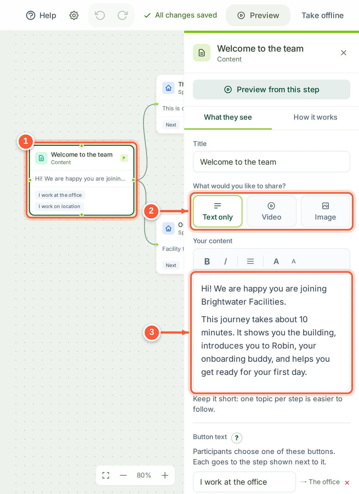

# Content Step

The Content Step displays text, videos, or an image to participants. It's perfect for sharing information, instructions, or multimedia content within your journey.

1. The Content step on the canvas.
2. What would you like to share: Text, Video or Image.
3. The text editor, with bold, italic, lists and text size.

## Overview

Content Steps are versatile building blocks for delivering information. They support:

- **Text Content**: Rich formatted text with headings, lists, and links
- **Video Content**: Embedded YouTube videos
- **Image Content**: Add an image

## Properties

Click the Content step on the canvas (1) to open its settings.

### What they see

| Property | Description |
|----------|-------------|
| **Title** | The heading for this content section |
| **Description** | Brief summary shown below the title |
| **Content Type** (2) | Choose between Text, Video or Image |

### Text Content

When using text mode:

- Write your content in the text editor (3)
- Use formatting options for headings, bold, italic

### Video Content

When using video mode:

| Property | Description |
|----------|-------------|
| **YouTube URL** | Paste a YouTube video link |
| **Video Preview** | Shows thumbnail of the selected video |

Supported formats:
- `https://www.youtube.com/watch?v=VIDEO_ID`
- `https://youtu.be/VIDEO_ID`

### What participants see

A video step does not load the video straight away. Participants first see a dark block with a **Play video** button and a short note: the video is on YouTube, and clicking the button connects their browser to YouTube (Google). Nothing is loaded from YouTube before that click. After the click, the video starts playing.

Google only receives a participant's IP address once they choose to watch. If your organization has a privacy notice for employees, mention there that video steps use YouTube.

With **After Delay** pacing, the timer starts when the video starts playing.

### Image

Pick an image from the Pexels database or upload your own image

## How it works

### Step Pacing

Control when participants can continue:

- **Immediate**: Participants can continue anytime
- **After Delay**: Wait X seconds before allowing progression

## Best Practices

### For Text Content

- Keep paragraphs short and scannable
- Highlight key points with bold text

### For Video Content

- Choose videos under 5 minutes for better engagement
- Ensure videos are relevant to the journey context
- Consider adding text summary below the video
- Use step pacing to make sure participants watch important videos

## Use Cases

- **Instructions**: Explain how to complete a task
- **Welcome Messages**: Introduce a section of the journey
- **Educational Content**: Share learning materials
- **Announcements**: Communicate important information
- **Video Tutorials**: Embed how-to videos

## Generated by the Journey Wizard

When you use the Journey Wizard, most of the stepping stones of a generated journey are Content Steps in **Text** mode. The wizard fills in the title, description and a short body of text based on your uploaded document or the topic you described. It does **not** automatically add images or videos; that's intentionally left for you to do afterwards. If the wizard decided to include a branching question, it will also produce a Content Step with two buttons whose button texts reflect the answer choices. See: journey-wizard.

## Related Features

- [[goto:/dashboard/journeys]] - Create journeys with Content Steps
- See: journey-builder, image-library, journey-wizard
