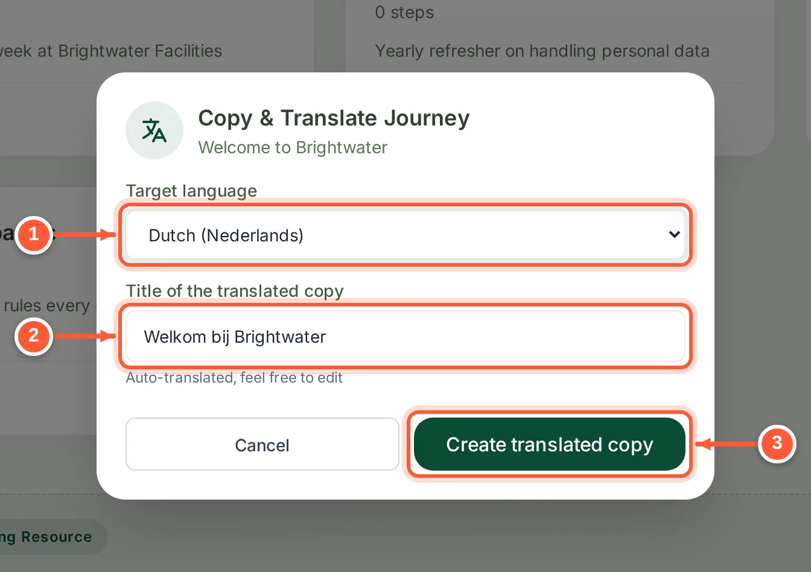

# Copy & Translate Journey

Copy & Translate allows you to create a translated copy of an existing journey in a different language. This is useful when you need to deliver the same content to audiences in multiple languages.

1. Target language: the language of the copy.
2. Title of the translated copy: filled in for you, you can change it.
3. Create translated copy: Gryffi makes the copy and translates every step.

## Overview

When you copy and translate a journey:

- A new draft journey is created with all content translated
- The original journey stays the same
- The language settings of the copy are set to the new language
- The AI guide of the journey stays linked, and its greeting is translated

Viewers cannot use Copy & Translate.

[[goto:/dashboard/journeys]]

## How to Copy & Translate

1. Go to the Journeys list
2. Find the journey you want to translate
3. Click the **⋮** (three dots) on the journey card
4. Select **Copy to another language**
5. In the window:
   - Select the **Target language** (1) from the list
   - Optionally change the **Title of the translated copy** (2)
6. Click **Create translated copy** (3)
7. Wait for the translation to finish. A progress bar shows the status.

## What Gets Translated

The following content is translated with AI:

| Content Type | Translated |
|--------------|:----------:|
| Journey title | Yes |
| Journey description | Yes |
| Step titles | Yes |
| Space descriptions | Yes |
| Content text and the description with a video or image | Yes |
| Quiz questions and answers | Yes |
| Quiz pass and fail messages | Yes |
| Form description, field labels and choices | Yes |
| Form email subject | Yes |
| Form confirmation message | Yes |
| Poll questions | Yes |
| Poll options | Yes |
| Reward title, description, redemption location and terms | Yes |
| Greeting in AI guide steps | Yes |
| Button texts | Yes |
| Resource names and descriptions | Yes |
| Opening sentence of the journey's AI guide | Yes |

## What's NOT Translated

Some content is copied but not translated:

- Images and media files
- File attachments
- Reward codes
- External URLs
- Step positions and layout
- Email automations

## Automatic Settings

When a translated copy is created, Gryffi sets these for you in the Journey Settings of the copy:

### Language for participants
- **Use a different language**: on, set to the target language
- **Use a different language for the guide**: on, set to the target language

### Fixed opening sentence
If the original journey has an AI guide for the whole journey, the guide's greeting is translated and stored as the "Fixed opening sentence". This means:
- The opening sentence loads right away, because the guide does not have to write one first
- The guide always starts with the same sentence
- You can change it yourself

## Supported Languages

You can translate to any of the supported languages:

### Base Languages
English, Dutch, German, French, Spanish

### Extended Languages
Italian, Portuguese, Danish, Norwegian, Finnish, Swedish, Polish, Romanian, Turkish

## After Translation

Once the translation is complete:

1. Gryffi shows that the translated copy is ready and takes you back to the Journeys list
2. Open the new journey in the builder
3. Review the translated content
4. Make changes where needed
5. The journey is saved as a **draft**. Publish it when it is ready.

### Editing the Fixed Opening Sentence

To change the translated opening sentence of the AI guide:

1. Open the translated journey in the builder
2. Click on empty canvas space to open Journey Settings
3. Find the "Language for participants" section
4. Edit the "Fixed opening sentence" field
5. The builder saves your change by itself

## Tips

- **Review translations**: AI translations are generally accurate, but always review important content
- **Quiz answers**: Double-check that quiz answer options are correctly translated
- **Placeholders**: Variables like `{{name}}` are kept as they are
- **HTML formatting**: Bold, italic, and other formatting is kept
- **Combine with the Journey Wizard**: build a first version with the Journey Wizard (which generates steps, texts and optionally an AI guide) and then use Copy & Translate to make copies for other language groups.

See: journey-wizard

## Translation Progress

During translation, you'll see a progress bar with these stages:

1. **Loading journey content**
2. **Translating content**: this takes the longest
3. **Creating translated journey**
4. **Translating the guide's greeting**: only when the journey has an AI guide
5. **Creating steps**
6. **Creating links**
7. **Finishing up**

## Troubleshooting

### Translation is slow
AI translation can take from 30 seconds to several minutes, depending on the amount of content. Don't close the window.

### Some content not translated
Check if the content type is in the "What Gets Translated" list.

### Translation failed
If translation fails, try again a few minutes later.

## Related Features

- [[goto:/dashboard/journeys]] - Journey list
- See: language-settings, journey-settings, ai-guides-overview, journey-wizard
