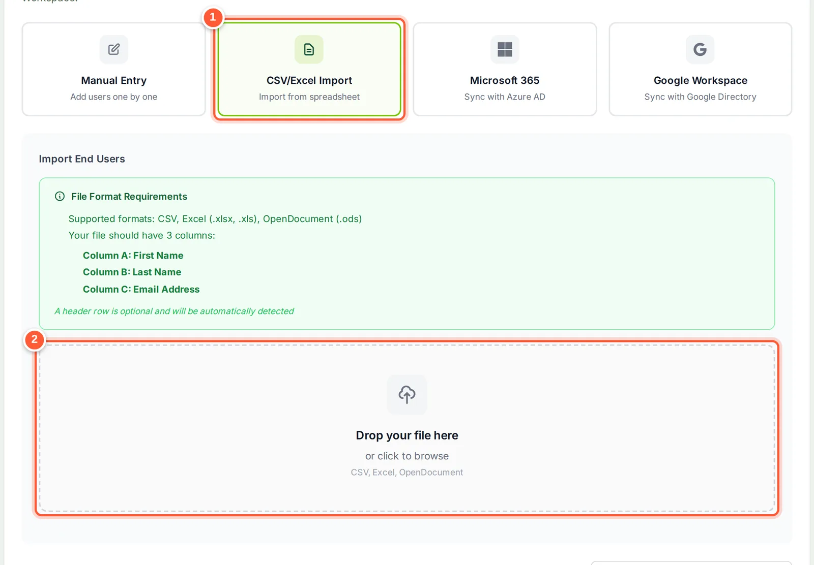

# CSV Import

CSV Import allows you to bulk upload participants to your organization using a spreadsheet file.



1. CSV/Excel Import on the Participants page.
2. Drop your file here, or click to choose it. A file has three columns: first name, last name and email address.

## Overview

CSV import enables:

- Adding many participants at once
- Skipping participants who are already there
- Preview before confirming

[[goto:/dashboard/participants#users/csv]]

## Preparing Your File

### Required Columns

Supported formats: CSV, Excel (.xlsx, .xls), OpenDocument (.ods). The maximum file size is 10 MB.

Your file should have 3 columns:
- Column A: First Name
- Column B: Last Name
- Column C: Email Address

All three are required in every row. Gryffi only reads the first sheet and columns A, B and C.

A header row is optional and will be automatically detected.

### Example CSV

```csv
first_name,last_name,email_address
John,Doe,johndoe@mycompany.com
Fred,Bucket,fredbucket@mycompany.com
```

## Importing

1. Go to Participants → CSV/Excel Import (1)
2. Drag your file to "Drop your file here" (2), or click it to choose a file
3. Check the Import Preview. It shows how many new participants will be imported, which participants already exist and which rows have a problem
4. Click "Yes, import participants"

## Handling Duplicates

Participants are matched by email address. If an email address already belongs to a participant in your organization, that row is skipped. No new participant is made.

If the same email address appears more than once in the file, only the first row is imported.

## Rows With a Problem

A row with a problem is skipped. The other rows are still imported. The preview lists each skipped row and the reason:

| Reason | Solution |
|-------|----------|
| first name is empty | Fill in column A |
| last name is empty | Fill in column B |
| email address is empty | Fill in column C |
| "..." is not a valid email address | Correct the email address |
| "..." appears more than once in the file | Remove the extra row |

Fix the rows in your file and import it again to add them. Participants that were already imported are skipped the second time.

If none of the rows can be imported, you see "Nothing was imported".

## Best Practices

- Clean data before import
- Verify email addresses
- Use consistent formatting
- Test with small sample first

## Related Features

- [[goto:/dashboard/participants#users/csv]] - Import participants
- [[goto:/dashboard/participants#users/manual]] - Manage participants

See: end-user-management, manual-user-entry, end-user-groups
