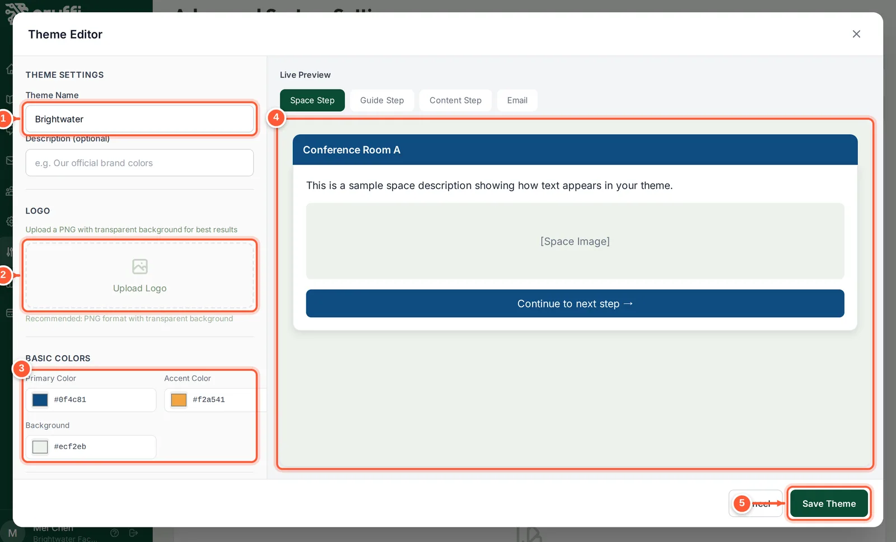
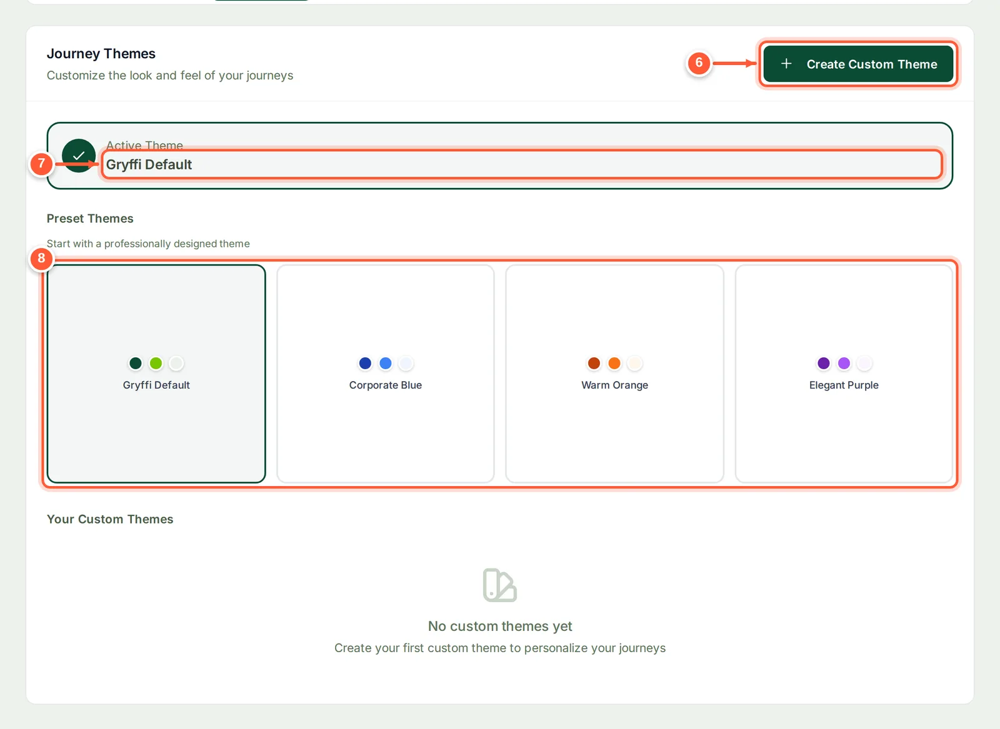

# Custom Themes

With custom themes, your journeys, emails and downloadable PDFs get the colors and logo of your organization. Only admins can create, edit, activate or delete themes.

1. Theme Name.
2. Logo: upload a PNG, preferably with a transparent background.
3. The colors, such as the primary and accent color.
4. Live Preview of a Space step, AI guide step, Content step and email.
5. Save Theme.

6. Create Custom Theme: your own colors and logo.
7. The theme your journeys use now.
8. Preset themes: click one to start a new theme with its colors.

## Overview

With a theme you set:

- Your colors
- Your logo
- Rounded corners and shadows

[[goto:/dashboard/system-settings#themes]]

## Theme Editor

### Opening the Editor

1. Go to Organization and open the **Themes** tab.
2. Click **Create Custom Theme** (6). Or click a preset theme (8) to start from its colors. Or click **Edit Theme** at one of your custom themes.
3. Change the colors and upload a logo.

### Color Settings

Colors that can be changed:

- **Basic Colors**: Primary Color, Accent Color, Background
- **Text Colors**: Primary Text, Secondary Text
- **UI Elements**: Card Background, Card Border, Button Text
- **Journey Specific**: Header Background, Progress Bar, Your Messages, Guide Messages

### Advanced

- **Border Radius**: how round the corners are, from 0 to 24 pixels.
- **Shadow Strength**: None, Light, Medium or Strong.

### Entering Colors

- Pick a color with the color picker.
- Or type a hex code with 6 characters, such as `#0b4b34`.

### Logo Settings

Upload a PNG logo, preferably with a transparent background. Gryffi makes a white version of the logo for dark backgrounds. The editor shows both versions.

## Creating a Theme

### Step 1: Name Your Theme

- Theme Name (1)
- Description (optional)

### Step 2: Set Colors

1. Change the colors (3) with the color picker or a hex code.
2. Check the result in the Live Preview (4). Switch between Space Step, Guide Step, Content Step and Email.

### Step 3: Upload Logo

1. Click **Upload Logo** (2).
2. Choose a PNG file on your computer.

### Step 4: Save and Activate

1. Click **Save Theme** (5).
2. Scroll down to **Your Custom Themes**.
3. Click **Set as Active** at your theme.

Saving alone does not change your journeys. The theme is used only after **Set as Active**.

## Applying Themes

The theme your journeys use now is shown as the **Active Theme** (7). To use another custom theme, click **Set as Active** at that theme. To go back to the standard look, click **Use Default**.

A preset theme (8) is a starting point. Clicking it opens the editor with its colors. Save it and click **Set as Active** to use it.

## Where the theme shows

### Journey Player

- Header bar
- Buttons
- Step cards
- Progress bar
- Chat messages of AI guides

### Emails

Emails to participants, such as invitations and reminders, use the colors and logo of the active theme.

### PDF reports

Analytics PDF reports use the colors and logo of the active theme.

## Best Practices

- Use the official colors of your organization.
- Check that text is easy to read on its background. Good contrast helps everyone, also people with low vision or dyslexia.
- Preview the journey on a phone.

## Related Features

- [[goto:/dashboard/system-settings#themes]] - Themes
- See: organization-settings, system-settings
