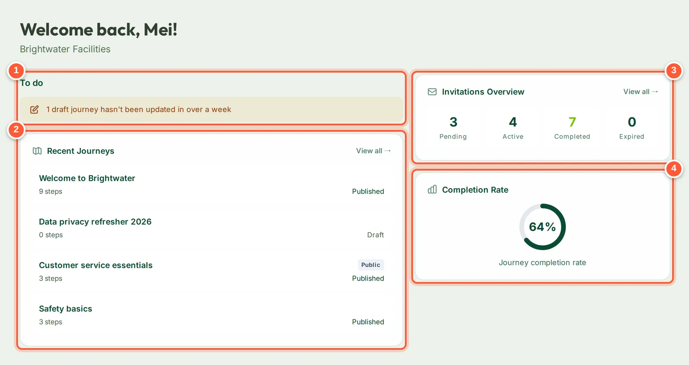

# Dashboard

The Dashboard is the first page you see after you log in. It shows what needs doing and how your participants are doing, and nothing more.

1. To do: things that need your attention, each with a link to where you fix it.
2. Recent journeys: the journeys you worked on last.
3. Invitations overview: how many invitations are waiting, active, completed and expired.
4. Completion rate: how many invited participants finished their journey.

[[goto:/dashboard]]

## What is on the Dashboard

### To do
This part only appears when something needs your attention. Each line is a link to the page where you can act:

- Invitations that expire within 3 days
- New filled-in forms this week (admins and journey managers)
- Draft journeys that have not changed for more than a week
- A reward that is running out of codes
- An AI guide that is used in a journey but has no documents yet, so it cannot answer questions

### Recent journeys
The journeys you worked on most recently. Click one to open it in the builder.

### Invitations overview
How many invitations are waiting, active, completed and expired. Click **View all** to go to Invitations.

### Completion rate
The share of invited participants who finished their journey.

### Usage
Usage appears only when you have used 80% or more of a limit, for example journeys, participants or AI credits. The full overview is in Analytics.

### Get started
A new organization sees a **Get started** card at the top of the Dashboard. It shows five steps from a first journey to the first person who finishes it:

1. Create a journey
2. View it as a participant
3. Publish it
4. Invite someone (you count too)
5. Someone finishes it

Steps that are done get a check mark, and a bar shows how far you are. Only the next step has a button, so there is always one clear thing to do. For steps 3 and 4 that button is **Send it to yourself**: Gryffi publishes the journey and emails you an invitation, so you see exactly what a colleague will get. Editors do not see this button, because only admins and journey managers can publish.

The card disappears once all five steps are done. You can also click **Hide** to remove it for yourself. While the card is visible, the Dashboard shows no tips.

### Tips
At the top of the Dashboard, Gryffi can show one tip at a time. A tip suggests a useful next step based on what your organization has done so far. For example: create your first journey, add participants, invite people to a published journey, or give an AI Guide its first documents.

- Only one tip is shown at a time, always in the same place.
- Each tip has one action button and a "Don't show this tip again" link.
- A tip disappears by itself once you have done what it suggests.
- Dismissing a tip is personal: it does not affect other makers in your organization.
- Viewers do not see tips.

## Role-Based Access

What you see on the Dashboard depends on your role:

- **Admin and Journey Manager**: everything above, including new form submissions and usage near a limit
- **Editor**: To do, recent journeys, invitations and completion rate
- **Viewer**: recent journeys; no To do and no tips

## Related Features

- [[goto:/dashboard/journeys]] - View all journeys
- [[goto:/dashboard/guides]] - Manage AI guides
- [[goto:/dashboard/invitations]] - Send invitations
- [[goto:/dashboard/analytics]] - View detailed analytics
