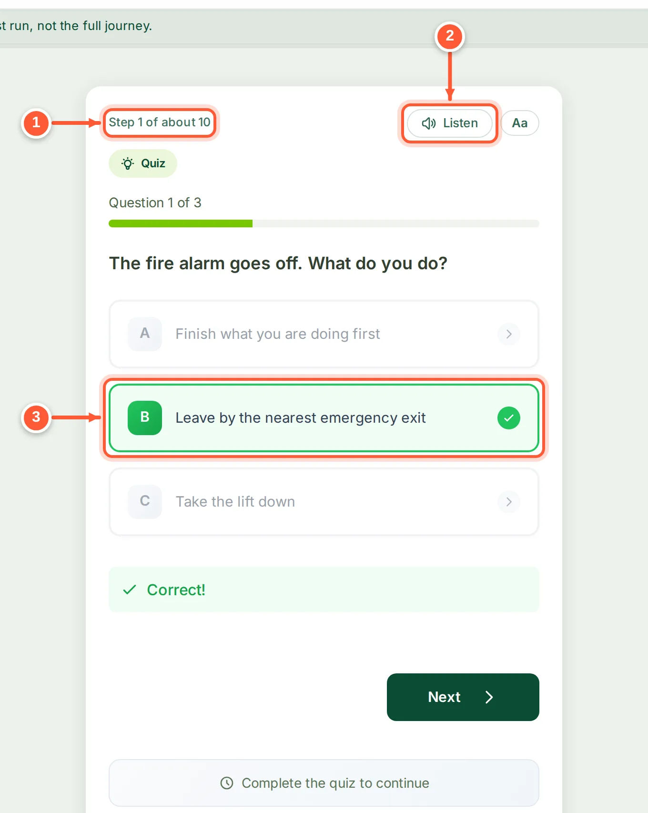

# Participant Experience

The Participant Experience describes how participants interact with journeys, from receiving invitations to completing content.

1. Where the participant is in the journey, for example Step 4 of 8. When the rest of the route depends on choices, it says Step 4 of about 8.
2. Listen: Gryffi reads the step aloud. Aa next to it changes the font.
3. An answered question. With feedback on, the participant sees right away that the answer is correct.

## Overview

Participants experience:

- Invitation and access
- Journey navigation
- Step completion
- Progress tracking
- Rewards

## Accessing Journeys

### Via Invitation

1. The participant receives an email invitation
2. Clicks the "Start Journey" button
3. Journey begins

The link is personal. On a third device, the participant first enters a verification code from their email.

See: magic-links

### Via public journey Link

1. The participant starts a journey from a website or intranet through the public link of the journey
2. At the first poll, form or reward step, the participant enters their name and email address. Then they confirm with a 6-digit code sent by email

See: public-journeys

### Continuing Later

Gryffi saves the progress. A participant can stop at any moment and continue later with the same link. When they come back, they see "You were here before. Do you want to continue where you left off?" with **Continue where I was** and **Start again**.

A participant who already completed the journey sees "Welcome back" when the invitation allows another completion. They can click **Start again** or **View previous attempt**.

### Mobile Experience

Optimized for mobile:
- Touch-friendly buttons
- Responsive layout

## Completing Steps

### Step Types

Participants interact with:
- **Space**: View locations image or 360 image, see where you are on a map
- **AI guide**: Chat with an AI guide
- **Content**: Read/watch content
- **Quiz**: Answer quiz questions (3)
- **Form**: Fill out forms
- **Poll**: Vote on questions
- **Reward**: Receive rewards
- **Sub-Journey**: Follow another journey inside this journey, then continue

## Controls for participants

In each step, the participant sees where they are in the journey (1), for example Step 4 of 8. When the rest of the route depends on choices, it says Step 4 of about 8. On the first step, it also shows about how many minutes the journey takes.

**Listen** (2) reads the step aloud. **Aa** next to it switches to a dyslexia-friendly font.

### When Complete

Participants see:
- Completion message
- Rewards (if configured)

## Related Features

See: journey-builder, invitations-overview, magic-links, public-journeys
