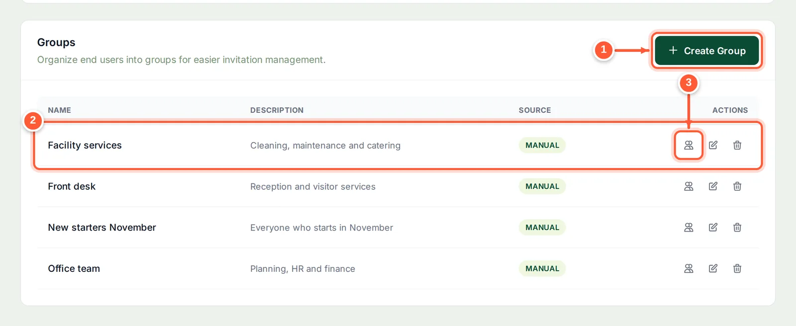

# Participant Groups

Participant Groups allow you to organize your participants into logical collections for easier management and targeted invitations

1. Create Group: give the group a name and a description.
2. A group with its description and source.
3. Manage members: add participants to the group or remove them.

## Overview

Groups help you:

- Organize participants by department, location, or role
- Send journey invitations to entire groups

[[goto:/dashboard/participants#users]]

## Creating Groups

### Manual Creation

1. Go to Participants → Groups
2. Click "Create Group" (1)
3. Enter group details:
   - **Group Name**: required, and each name can be used once
   - **Description (optional)**: purpose of the group
4. Click "Save"

## Adding Participants to Groups

### Individual Assignment

1. Go to a group (2)
2. Click the "Manage members" icon (3)
3. Select participants to add
4. Click on "Add Members"
5. Click "Close"

### Via Directory Sync

When syncing from Microsoft 365 or Google Workspace:
- Directory groups can be imported as Gryffi groups, with the source Microsoft or Google
- Group memberships are updated at every sync

Every sync sets the members of a synced group to the members in your directory. If you add or remove members of a synced group by hand in Gryffi, the next sync undoes that. Change the members in your directory instead.

### Via Gryffi API

Groups can be managed by our API
- List groups
- Create group
- Add members
- Remove members
- Remove group (only if empty)

## Using Groups

### Journey Invitations

Send invitations to entire groups:

1. Go to Invitations
2. Follow the invitation wizard step by step
3. In step 3 of the wizard you can go to the tab "Groups"
4. Choose one or more group(s)
5. Send invites

Each member receives their own personal invitation link.

[[goto:/dashboard/invitations]]

## Group Management

### Editing Groups

- Groups with the source Manual: change name or description with the pencil icon, and add or remove members
- Groups with the source Microsoft or Google: no edit or delete buttons. Their name and members come from your directory

### Deleting Groups

Only groups with the source Manual can be deleted here. When deleting a group:
- Members are NOT deleted
- Participants lose group association

When you disconnect Microsoft 365 or Google Workspace, the synced groups stay. The page then shows "Microsoft Groups Without Connection" or "Google Groups Without Connection". Click "Delete Groups" there to delete them all.

## Related Features

- [[goto:/dashboard/participants#users]] - Manage groups
- [[goto:/dashboard/invitations]] - Send group invitations

See: end-user-management, invitations-overview, microsoft-365-sync, google-workspace-sync
