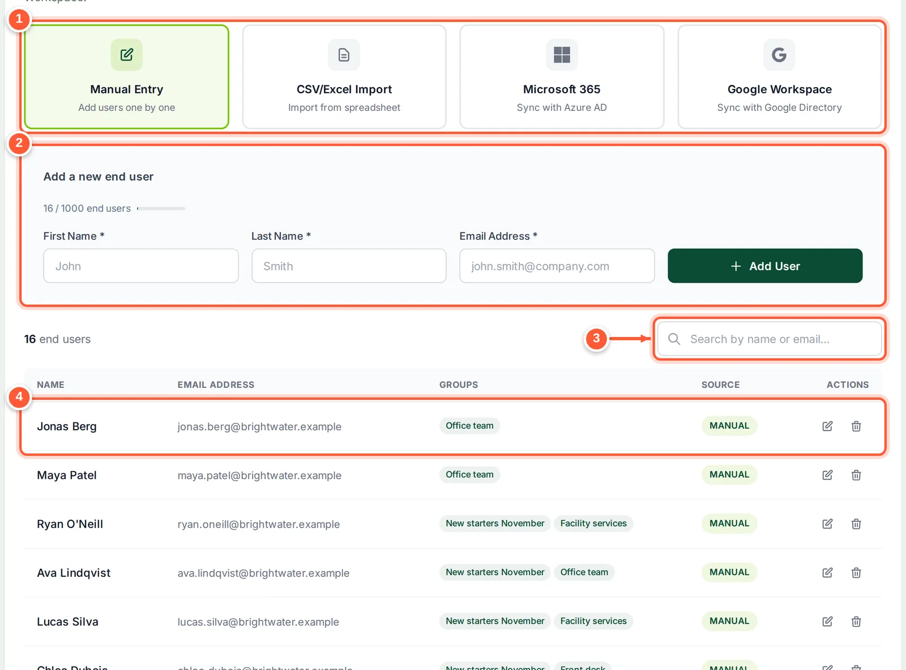

# End User Management

End User Management allows you to add, organize, and manage the people who participate in your journeys.

1. Four ways to add end users: Manual Entry, CSV/Excel Import, Microsoft 365 and Google Workspace.
2. Add a new end user by first name, last name and email address.
3. Search by name or email address.
4. An end user with their groups and where they come from (Source).

## Overview

End users are the participants who experience your journeys. You can:

- Add users manually, via spreadsheet import or sync with microsoft/google
- Organize users into groups

[[goto:/dashboard/system-settings#users]]

## End Users vs Makers

| End Users | Makers |
|-----------|--------|
| Experience journeys | Create journeys |
| Complete steps and challenges | Build and edit content |
| Receive rewards | Manage users and settings |
| No access to builder | Full dashboard access |
| No login but magic-link | Needs to login the Gryffi webapp |

## Adding End Users

### Manual Addition

1. Go to System Settings - Users
2. Click "Manual Entry" (1)
3. Enter user details (2):
   - First Name
   - Last Name
   - Email (required)
4. Click "Add User"

### Bulk Import (CSV)

Upload multiple users at once:

[[goto:/dashboard/system-settings#users]]

- You can upload a spreadsheet file with firstname, lastname and email address.

See: csv-import for detailed instructions

### Directory Sync

Automatically sync from:
- Microsoft 365 / Azure AD
- Google Workspace

See: microsoft-365-sync, google-workspace-sync

## User Profile Fields

### Standard Fields

| Field | Description |
|-------|-------------|
| **First Name** | User's first name |
| **Last Name** | User's last name |
| **Email** | Primary identifier (required) |

In the list, each end user (4) shows their groups and where they come from (Source). Use search (3) to find an end user by name or email address.

[[goto:/dashboard/system-settings#users]]

## User Groups

Organize users into groups for:

- Targeted journey assignments

See: end-user-groups

## Privacy & Compliance

### Data Handling
- User data is encrypted at rest
- GDPR compliance features available

## Related Features

- [[goto:/dashboard/system-settings#users/manual]] - User list
- [[goto:/dashboard/system-settings#users/csv]] - CSV import
- [[goto:/dashboard/system-settings#users/microsoft]] - Directory sync Microsoft
- [[goto:/dashboard/system-settings#users/google]] - Directory sync Google
- See: end-user-groups, csv-import
