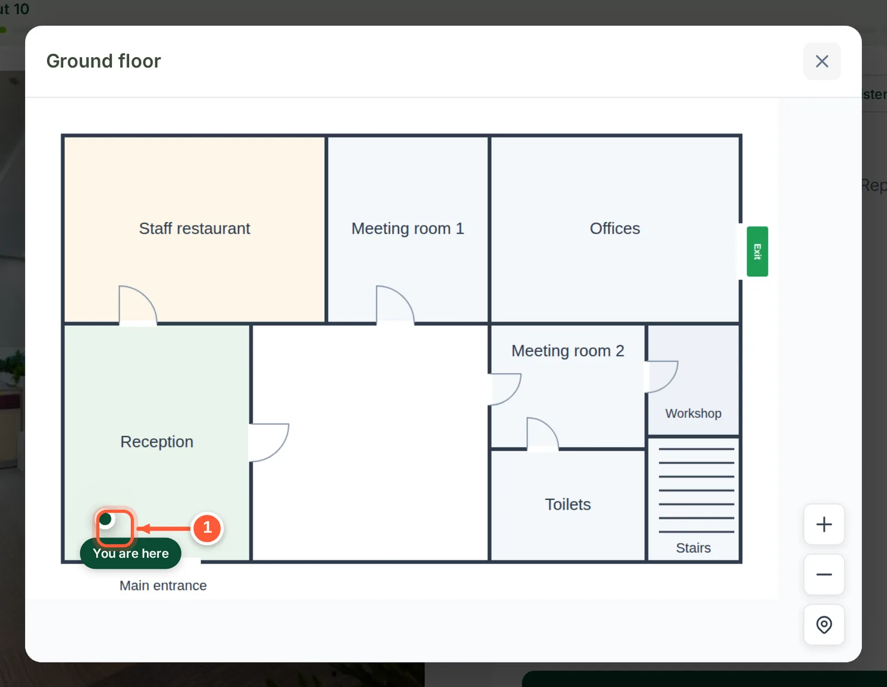

# Floor Plans

A floor plan is a map you add to a Space step. Participants see on the map where the location of the step is, for example during a virtual tour of a building.

1. The marker shows where the participant is: You are here. Participants open the floor plan with View floor plan in a Space step.

## Overview

Participants open the floor plan with **View floor plan** in a Space step. A marker with the text **You are here** shows the location of that step (1). They can zoom in and out on the map.

Each Space step has one marker. Several Space steps can use the same floor plan, each with the marker on its own location.

## Setting up a floor plan

### Step 1: Turn on the floor plan

1. Select a Space step.
2. Open the **What they see** tab.
3. Tick **Show floor plan**.

### Step 2: Choose or upload a map

To use a map that is already uploaded, choose it under **Select floor plan**.

To upload a new map:

1. Click **Upload new floor plan**.
2. Give your floor plan a name. The name is required.
3. Add a description if you want. This is optional.
4. Choose your map image: a JPEG, PNG or WebP file.
5. Click **Upload**.

### Step 3: Place the marker

1. Click on the floor plan image at the spot where this Space step is.
2. The marker appears on that spot. Click somewhere else to move it.

## Managing floor plans

Uploaded floor plans are available under **Select floor plan** in every Space step of your organization. Choose a floor plan there to see the buttons **Edit floor plan** and **Delete floor plan**.

### Rename a floor plan

1. Choose the floor plan under **Select floor plan**.
2. Click **Edit floor plan**.
3. Change the name or the description.
4. Click **Save**.

The new name shows in every step that uses the floor plan.

### Delete a floor plan

1. Choose the floor plan under **Select floor plan**.
2. Click **Delete floor plan**.
3. Gryffi tells you in how many steps the floor plan is shown. Click **Delete** to confirm.

**Show floor plan** is turned off in every step that used it, so participants no longer see **View floor plan** there. The map image is deleted too. This cannot be undone. To use a different map, upload a new floor plan and place the markers again.

## Tips

- Use simple, clear maps.
- Use the same scale for every floor.
- Add a legend if needed.

## Use Cases

- Office building tours
- Campus navigation
- Museum floor guides
- Real estate virtual tours
- Hospital wayfinding

## Related Features

- See: space-step, image-library
