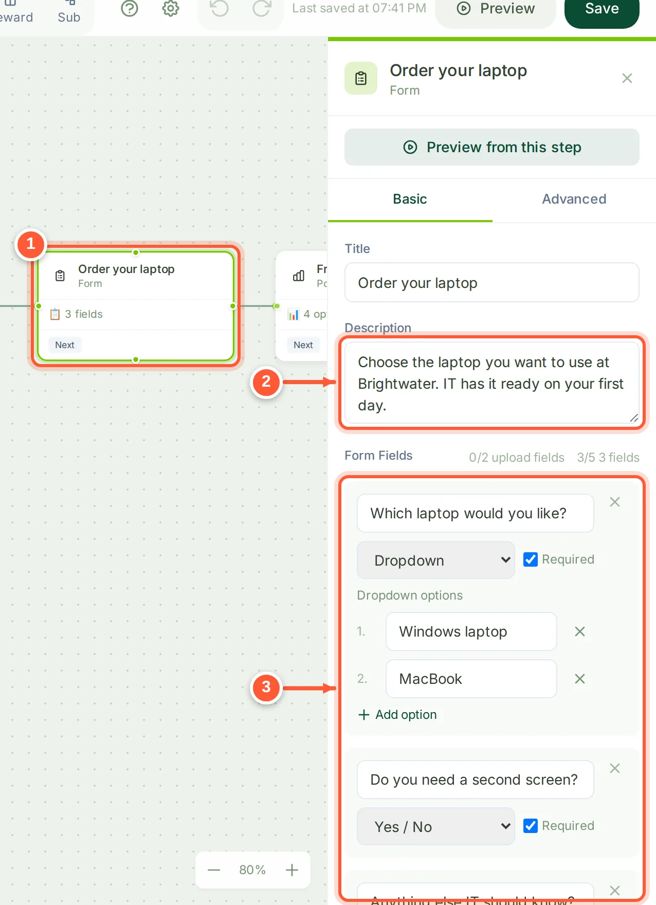

# Form Step

The Form Step collects data from participants through customizable input fields. Use it for registrations, feedback, surveys, or any data collection needs. When a participant submits a form, the responses are emailed to the recipient configured in the step, and the submission is stored securely on the Gryffi platform so admins and journey managers can review it later in the Analytics dashboard.

1. The Form step on the canvas.
2. Description: tells participants what the form is for.
3. Form fields: for each field the question, the type (such as Dropdown or Yes / No) and whether it is required.

## Overview

Form Steps allow you to:

- Create custom forms with multiple field types
- Collect answers from participants
- Make fields required or optional

## Properties

Click the Form step on the canvas (1) to open its settings.

### What they see

| Property | Description |
|----------|-------------|
| **Title** | The form name (e.g., "Registration Form") |
| **Description** (2) | Instructions for filling out the form |
| **Form Fields** | The fields that make up the form |

### Form Fields

Each form can contain multiple fields (3):

| Field Type | Description | Use Case |
|------------|-------------|----------|
| **Short Text** | Single line text input | Name, email, phone |
| **Long Text** | Multi-line text input | Comments, feedback |
| **Dropdown** | Dropdown selection with multiple options | Choose from options |
| **Yes No** | Single choice from options | Yes/No questions |
| **File upload** | File upload | Documents, images, audio |

### Adding Fields

1. Click "Add Field" button
2. Choose the field type
3. Enter the field question
4. Set whether it's required
5. Configure field-specific options

## What Happens After Submission

When a participant submits the form:

1. The submission is saved securely on the Gryffi platform. Submissions are strictly organization-scoped: only your own organization can ever access them.
2. A notification email with all responses is sent to the recipient configured in the step. See: form-email-settings
3. Uploaded files are stored on the platform and included in the email as secure download links. Files are never attached to the email itself. See: form-file-uploads
4. Admins and journey managers can review the submission in Analytics → Forms. See: form-submissions

If the notification email cannot be delivered, the submission is still saved and remains available in the Analytics Forms tab.

### Testing a form in the preview

When you submit a form in the builder preview, the notification email goes to you, the maker who is testing, with "[Preview]" in the subject. The recipient configured in the step gets nothing. A preview submission is not saved in Analytics.

## Use Case examples

- **Event Registration**: Collect attendee information
- **Feedback Forms**: Gather opinions from participants
- **Contact Forms**: Let participants ask questions
- **Applications**: Collect detailed information from participants
- **Surveys**: Multi-question data collection
- **Check-in Forms**: Track attendance

## Generated by the Journey Wizard

The Journey Wizard can include a Form Step when you choose the **Extended (7 steps)** length. The generated form contains a few short-text fields relevant to your topic, and its **Send form to** recipient is pre-filled with your own maker email so submissions work immediately in preview. Review the fields and change the recipient address on the form's What they see tab before publishing. See: journey-wizard, form-email-settings.

## Related Features

- [[goto:/dashboard/analytics#forms]] - View form submissions
- See: journey-builder, form-submissions, form-email-settings, form-file-uploads, journey-wizard
