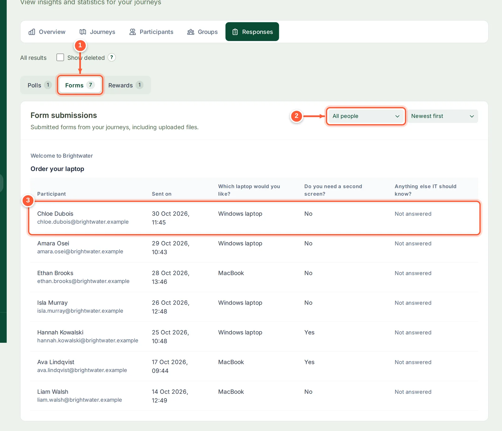

# Form Submissions

Form Submissions show all answers that participants sent through Form Steps in your journeys. You find them on the **Forms** tab in Analytics.

1. The Forms tab in Analytics, with the number of submissions.
2. Show the submissions of everyone or of one person.
3. A submission with the answers, the name of the participant and the date.

## Overview

Every form submission is saved in Gryffi. Only your own organization can see its submissions. This applies to submissions from:

- Private journeys (opened through an invitation link)
- Public journeys

Submissions made in the journey preview are not saved in Analytics. If **Send form to** is filled in, the preview email goes to you, the maker who is testing, with "[Preview]" at the start of the subject. The address in the step gets nothing. Without an address, nothing is sent.

See: journey-preview

[[goto:/dashboard/analytics#forms]]

## Who Can View Submissions

Every maker role can open Analytics, including the Forms tab: Admin, Journey Manager, Editor and Viewer. They can all read submissions and download uploaded files. Form submissions can contain personal data, so think about who gets a maker account.

See: maker-roles

## Viewing Submissions

### Access Form Submissions

1. Go to Analytics and open the **Forms** tab (1). The number on the tab is the number of submissions.
2. When forms in more than one journey have submissions, use the journey filter to show one journey.
3. Use the filter (2) to show the submissions of **All people** or of one person.
4. Choose the order: **Newest first**, **Oldest first**, **By person (A-Z)** or **By form (A-Z)**.

### Submission Details

Each submission (3) shows:

| Detail | Description |
|--------|-------------|
| Journey and form title | The journey and Form Step the submission belongs to |
| Answers | All answers. An empty answer shows "Not answered". |
| Participant | Name and email address of the participant |
| Date and time | When the form was submitted |
| Email status | **Email sent** or **Email not sent** |
| Private or Public | Whether the submission came from a private (invited) or a public journey |

### Uploaded Files

If the form has File upload fields, each submission lists the uploaded files with:

- The file name
- The file size and the field it was uploaded in
- A **Download** button

Files stay downloadable here after the download links in the notification email have expired (links work for 30 days).

See: form-file-uploads

## Retention

Submissions stay in Analytics when you delete the Form Step in the builder, or when a journey is deleted for good from the trash. Their uploaded files stay too.

You only see them when you turn on the switch **Show deleted journeys and steps** at the top of Analytics. It is off by default. With the switch on, deleted journeys and steps are marked **Deleted**.

An admin can remove these results for good:

1. Turn on **Show deleted journeys and steps**.
2. On the Overview tab, find the card **Deleted journeys and steps**.
3. Click **Delete results** next to the journey or step.
4. Confirm with **Delete for good**.

This deletes the form submissions and their files, together with the other results of that journey or step. You cannot undo this. Only an admin sees **Delete results**.

Submissions are also deleted in these cases:

- When you delete a participant, their submissions go too.
- Submissions from private journeys are removed together with their invitation. Gryffi removes completed and expired invitations after 1 year.

See: trash, analytics-overview

## Delivery Reliability

The submission is always saved before the notification email is sent. If the email cannot be delivered, the submission still shows on the Forms tab, so no answers are lost.

See: form-email-settings

## Related Features

- [[goto:/dashboard/analytics#forms]] - View form submissions
- See: form-step, form-email-settings, form-file-uploads, analytics-overview
