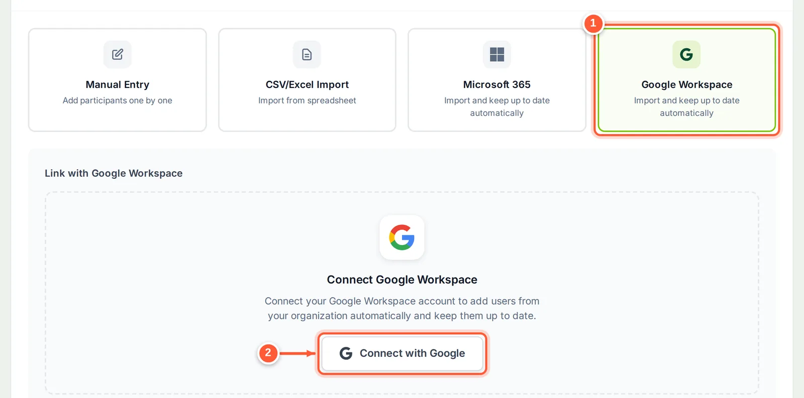

# Google Workspace Sync

Google Workspace Sync automatically imports and synchronizes your participants from Google Workspace (formerly G Suite).

1. Google Workspace: sync participants and groups from Google Workspace.
2. Connect with Google: a Google Workspace administrator gives Gryffi access.

## Overview

With Google Workspace Sync, you can:

- Automatically import participants from Google Workspace
- Keep participant information synchronized
- Import Google Groups as participant groups
- Spend less time on adding and removing participants by hand

## Prerequisites

Before connecting:

1. **Super Admin** role in Google Workspace
2. **Admin role** in Gryffi organization

In the Community Edition, an admin first registers an OAuth client in Google Cloud Console. Then the admin enters its Google client ID and Google client secret on the Installation page, section Integrations. Until then, the Participants page shows "Google Workspace link not set up".

## Connecting Google Workspace

### Step 1: Navigate to Sync Settings

Go to Participants and choose **Google Workspace** (1).

[[goto:/dashboard/participants#users/google]]

### Step 2: First make your Google Workspace ready for the sync

Before connecting, your Google Workspace administrator needs to authorize this application. Click "Show setup instructions" on the page to see these steps with the values to copy.

1. Open Google Admin Console
Go to admin.google.com and sign in with your administrator account.

2. Navigate to API Controls
Go to Security → Access and data control → API controls → Domain-wide delegation.

3. Add API Client
Click 'Add new' and enter the following details:

Client ID: copy it from the setup instructions on the page. Use the "Copy" button next to it.

OAuth Scopes:
https://www.googleapis.com/auth/admin.directory.user.readonly, https://www.googleapis.com/auth/admin.directory.group.readonly

4. Authorize
Click 'Authorize' to save the settings. You can now connect your Google Workspace account.

Important
Only a Google Workspace Super Admin can set up domain-wide delegation. If you're not the admin, please share these instructions with them.

### Step 3: Click "Connect with Google"
Click **Connect with Google** (2). You'll be redirected to Google sign-in.

### Step 4: Sign In
Log in with your Google Workspace super admin account.

### Step 5: Grant Permissions
Approve all the permissions for Gryffi.

### Step 6: Choose What to Import
After connecting, choose what to import under **What to import**. Then click **Save settings**.

## Sync Configuration

### Which users to import

| Option | Description |
|--------|-------------|
| **Import all users** | Import all active users from Google Workspace |
| **Import users from specific groups** | Only import users who are members of the groups you select |

Only active (non-suspended) users are imported.

### Groups

| Option | Description |
|--------|-------------|
| **Also import groups** | Import groups and who is in them, along with the users |
| **Also import members of selected groups as users** | Users from selected groups are added to your participants list |

Synced groups get the source Google. Every sync sets their members to the members in Google Workspace.

See: end-user-groups

### Sync Schedule

Gryffi updates automatically every 15 minutes. Click **Update now** if you don't want to wait. The page shows the number of linked users and groups and the time of the last update.

## What a Sync Changes

Every sync:
- Adds new users
- Updates users that are already there
- Removes users you no longer include, for example a user who left Google Workspace, was suspended or is no longer in a selected group

Removing a participant also deletes their invitations, their progress in journeys and their form submissions. This cannot be undone.

### Safety limit

Gryffi does not remove anyone in a sync when:
- More than 3 people, and more than 10% of the synced participants, would be removed at once
- Part of the directory could not be read

New and changed users are still updated. When you click **Update now**, the message then says: "Some users were not removed for safety, because more than 10% would have been removed." Check your settings under What to import and your groups in Google Workspace.

Participants from Google Workspace cannot be edited or deleted on the Participants page. Change them in Google Workspace.

## Disconnecting

Click **Disconnect**. Users that were already imported stay in Gryffi, but they are no longer updated. The page then shows "Google Users Without Connection" and "Google Groups Without Connection":
- Connect again to keep them up to date
- Or click **Delete All** to delete all participants imported from Google Workspace, and **Delete Groups** to delete the imported groups

## Related Features

- [[goto:/dashboard/participants#users/google]] - Sync settings
- [[goto:/dashboard/participants#users/google]] - View synced users

See: end-user-management, end-user-groups, microsoft-365-sync
