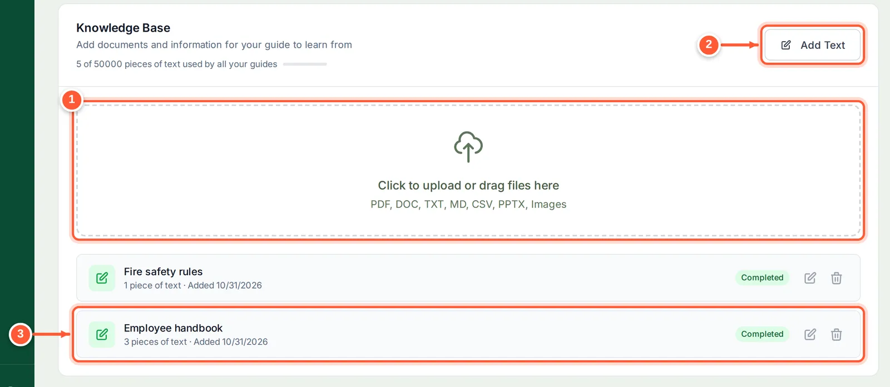

# Guide Knowledge Base

The knowledge base holds the content your AI guide uses to answer questions. Upload documents or type texts with the information the guide needs.

1. Click to upload files or drag them here: PDF, Word, text, Markdown, CSV, PowerPoint or images.
2. Add Text: type or paste knowledge without a file.
3. A knowledge source with its number of pieces of text and status. Completed means the guide can use it.

## Overview

The knowledge base:

- Stores the content of your guide
- Is where the guide finds its answers
- Makes source citations possible
- Can be changed at any time

[[goto:/dashboard/guides]]

## Adding Content

### Document Upload

Click the upload area (1) or drag your files onto it. You can upload several files at once. Each file can be at most 50 MB.

| Format | How Gryffi reads it |
|--------|---------------------|
| PDF | Text is taken from the pages |
| Word (.doc, .docx) | Text is taken from the document. Layout is not kept. |
| PowerPoint (.pptx) | Text is taken from the slides |
| Images (PNG, JPG, WebP, GIF) | Text in the image is read |
| Text (.txt) | Plain text |
| Markdown (.md) | Plain text |
| CSV | The rows as text |

Gryffi turns every file into plain text. After the upload the source shows **Processing**. When it shows **Completed**, the guide can use it. When it shows **Failed**, the reason is shown below the source.

### When PDF, Word and PowerPoint files cannot be read

PDF, Word, PowerPoint and image files are read by a separate document reader. On a self-hosted installation this reader can be switched off. The file then fails with a message that reading these files is switched off. Text, Markdown and CSV files still work. Add the content as text instead, or ask the administrator of your installation to turn on the document reader.

### Manual Content

Type content directly:

1. Click **Add Text** (2).
2. Enter a **Title**.
3. Type or paste the content your guide should know in **Content**.
4. Click **Add Knowledge**.

To change a text later, click **Edit** next to it.

### Filling the Knowledge Base with the Journey Wizard

When you create a journey with the Journey Wizard and upload a document in the first step, the wizard can create a new AI guide from that document. The document goes through the same steps as a normal upload: the text is read, split into pieces of text and stored. The result is the same as uploading the document yourself on the page of the guide. After the wizard is done, you can add more documents or texts to the guide.

See: journey-wizard

## Content Organization

### View Content

Each knowledge source (3) shows:
- The name of the file or text
- Whether it is a file or a text
- The number of pieces of text it uses
- The date it was added
- Its status: Pending, Processing, Completed or Failed

### Delete Content

Remove outdated or wrong content:
- Click the trash icon next to the document or text.

## Pieces of text

Gryffi splits the text of each source into pieces of text and stores them in the database. A larger document uses more pieces of text. Next to the heading **Knowledge Base** you see how many pieces of text all your guides use together.

## How the guide finds answers

The guide is not trained on your documents. It looks up the answer every time:

1. **Search**: when a participant asks a question, Gryffi searches the pieces of text of the guide. It picks the pieces that fit the question best.
2. **Answer**: these pieces of text are given to the AI together with the question.
3. **Sources**: the AI writes the answer from those pieces of text and refers to the sources it used.

This way of working is called RAG (retrieval-augmented generation). It has these advantages:

- Answers are based on your own content, so the guide makes up less.
- When you change the knowledge base, the guide uses the new content right away. No retraining is needed.
- The guide can answer from your own documents, which were never part of the training of the AI.

## Related Features

- [[goto:/dashboard/guides]] - Manage AI guides
- See: ai-guides-overview, guide-step, journey-wizard
