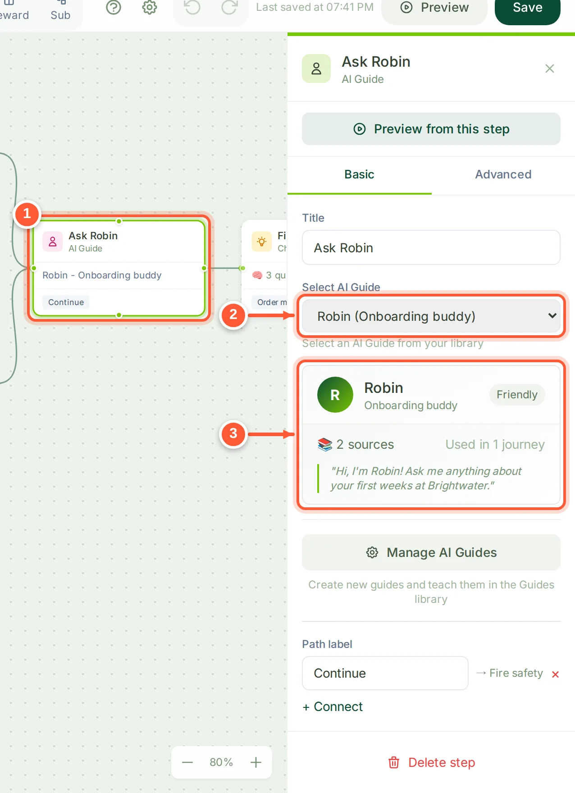

# AI Guide Step

The AI guide step embeds an AI-powered conversational assistant into your journey. Participants can ask questions and receive intelligent responses based on your knowledge base.

1. The AI guide step on the canvas.
2. Select AI Guide: choose one of the guides of your organization.
3. The selected guide, with its personality, knowledge sources and greeting.

## Overview

AI guide steps bring your AI Guides into the journey experience. When a participant reaches an AI guide step, they can:

- Chat with the AI assistant
- Ask questions about the topic
- Receive contextual help and information
- Get cited sources for answers

## Properties

### What they see

| Property | Description |
|----------|-------------|
| **Select Guide** | Choose which AI Guide to use at this step |

### Guide Selection

You must first create an AI Guide before using it in an AI guide step. Click the AI guide step on the canvas (1) to open its settings. The dropdown **Select AI Guide** (2) shows all available guides in your organization. Below it you see the selected guide with its personality, knowledge sources and greeting (3). The guides can be created in the main dashboard under Guides.

[[goto:/dashboard/guides]]

**Shortcut via the Journey Wizard:** when creating a new journey with the Journey Wizard, you can choose to add an AI guide step as part of the generated journey. The wizard will either create a new AI Guide (with a name you pick, and optionally a knowledge base seeded from your uploaded document) or reuse an existing Guide. The resulting AI guide step behaves exactly like one you'd add manually: you can still change the selected Guide afterwards. See: journey-wizard.

### A guide in other steps

You can also add a guide to a step that is not an AI guide step. Open that step and choose a guide under Guide in this step on the How it works tab. See: step-assistant.

## How It Works

1. The participant reaches the AI guide step in their journey
2. The AI Guide appears in a chat interface
3. The participant can type questions
4. AI responds using knowledge from its knowledge base that you provided
5. Sources are cited when applicable
6. The participant can continue the conversation or proceed to the next step

## Language Settings

The AI Guide in an AI guide step responds in the language configured for your organization by default. You can override this behavior:

1. Open Journey Settings (click on the canvas background)
2. Enable "Override AI Guide language"
3. Select the desired language

The AI Guide will then respond in the selected language, and its greeting will be automatically generated in that language. This works with both base languages (English, Dutch, German, French, Spanish) and extended languages (Italian, Portuguese, Danish, Norwegian, Finnish, Swedish, Polish, Romanian, Turkish).

See: journey-settings, language-settings

## Best Practices

### Preparing Your Guide

Before using an AI guide step, ensure your AI Guide has:

- A well-populated knowledge base
- Clear personality and identity settings
- Fitting extra instructions for the guide

## Use Case examples

- **Training**: Answer employee questions during onboarding
- **Support**: Provide instant help within a customer journey
- **Education**: Explain complex topics in an interactive way
- **Tours**: Let participants ask questions about exhibits or locations

## Related Features

- [[goto:/dashboard/guides]] - Create and manage AI Guides
- See: ai-guides-overview, guide-knowledge-base
