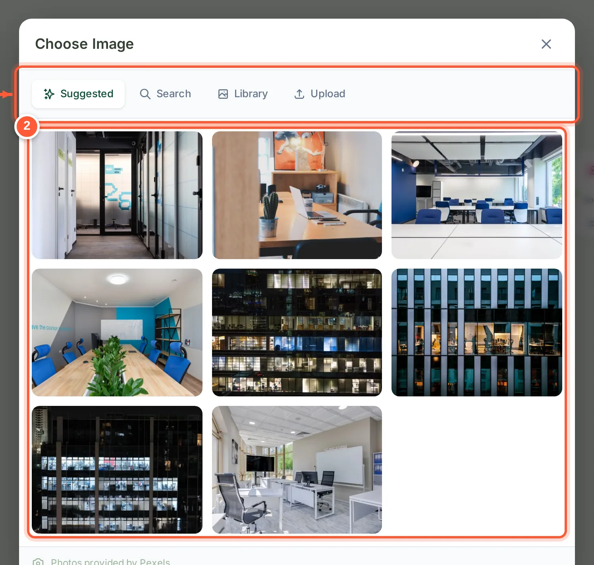

# Image Library

The image library holds the images your organization uses in its journeys. Reuse them in other steps, so you don't have to upload the same image twice.

1. Suggested, Search, Library and Upload: suggestions, photos from Pexels, the images of your organization, or a file of your own.
2. Click an image to use it in the step.

You open the Choose Image window from a step in the builder, for example with **Choose an image** in a Content step or **Add image** and **Change** in a Space step.

The tabs (1) let you pick:

- **Suggested**: free photos from Pexels that fit the title of the step
- **Search**: search free photos on Pexels
- **Library**: the images of your organization
- **Upload**: a file of your own: JPEG, PNG, GIF or WebP, up to 10 MB

Click an image (2) to use it in the step.

## What is in the library

The **Library** tab shows the images that are used right now in a step of your organization's journeys, or as the photo of an AI guide. An image you uploaded but no longer use does not show in the library.

## Pexels photos

Suggested and Search use Pexels, a site with free photos. If these tabs stay empty, no Pexels API key is set. In a self-hosted installation, an admin adds the key on the **Installation** page under **Integrations**.

## Related Features

- [[goto:/dashboard/journeys]] - Open a journey in the builder and choose an image in a step
- See: space-step, content-step
