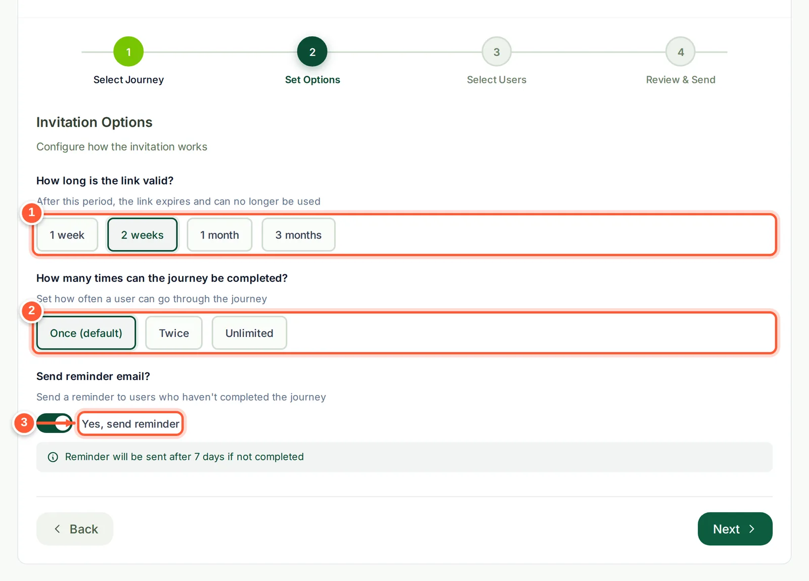

# Invitation Options

Invitation Options provide settings for customizing how journey invitations are sent and tracked. These options are part of the Send Invitations Wizard.

1. How long is the link valid: 1 week, 2 weeks, 1 month or 3 months.
2. How many times can the journey be completed: once, twice or unlimited.
3. Send reminder email: a reminder goes out when the end user has not finished the journey.

## Configure how the invitation works:

### How long is the link valid?
Choose how long the link is valid (1). After this period, the link expires and can no longer be used
- 1 week
- 2 weeks
- 1 month
- 3 months

### How many times can the journey be completed?
Set how often a user can go through the journey (2)
- Once (default)
- Twice
- Unlimited

### Send reminder email?
Send a reminder (3) to users who haven't completed the journey, this reminder will be send half way through the period that is set. So if the magic link expires in 2 weeks, then the reminder will be send after 1 week.

- Yes, send reminder
- No reminder

## Related Features

- [[goto:/dashboard/invitations]] - Send invitations
- See: invitations-overview, invitation-reminders
