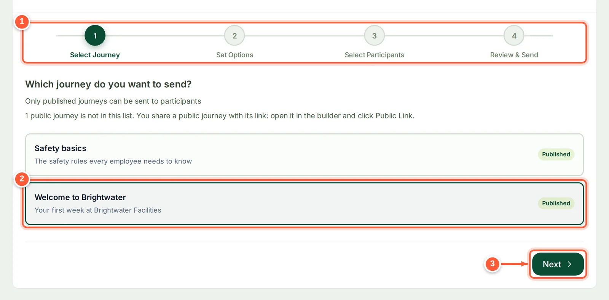
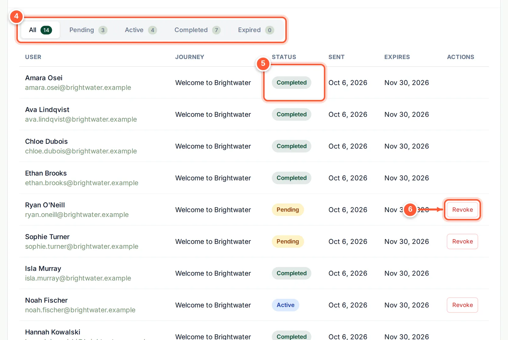

# Invitations Overview

The Invitations feature allows you to invite end users and end user groups to journeys via with a magic link in an email with personalized messages.

1. The four steps of the wizard: Select Journey, Set Options, Select Users and Review & Send.
2. Choose the journey. Only published journeys are listed.
3. Next: go to the options of the invitation.

4. Filter the list by status: Pending, Active, Completed or Expired.
5. The status of each invitation.
6. Revoke: the link of an invitation that is not completed stops working.

## Overview

Invitations help you:

- Notify users about available journeys
- Track who has been invited
- Monitor invitation acceptance rates
- Send reminders to non-responders

[[goto:/dashboard/invitations]]

## Sending Invitations

### Invitation Wizard

The wizard has four steps (1):

1. Select journey: Select a private published journey (2). You can not select drafts or public journeys. Click **Next** (3) to go to the options.
2. Set options: Give options about when a journey magic link expires. Or other options like notifications and the amount of times the end user can do their presonal journey.
3. Select users: Select one or more end users or one or more groups.
4. Review & Send: Review what invitation emails you are sending and to who.

### Send invitation through the API

You can also use our Gryffi API to send invitations. Configure the API in System Settings - API. 

### Sent Invitations

The list of sent invitations shows the status of each invitation (5). Use the status filter (4) to show only Pending, Active, Completed or Expired invitations. Click **Revoke** (6) on an invitation that is not completed to make its link stop working.

## Related Features

- [[goto:/dashboard/invitations]] - Manage invitations
- [[goto:/dashboard/invitations]] - Send new invitation
- See: end-user-management, end-user-groups
