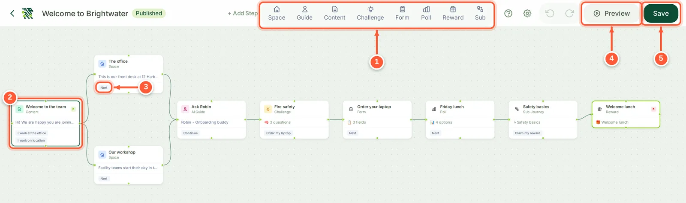
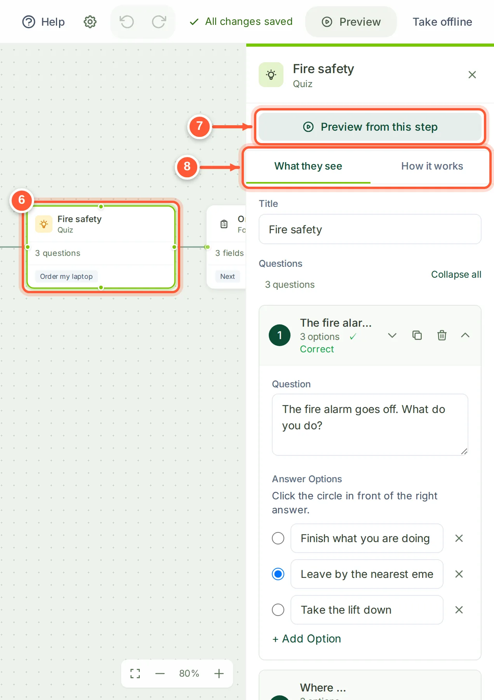

# Journey Builder

The Journey Builder is Gryffi's visual editor for creating interactive journeys. It uses a canvas where you can add steps, link them, and create branching experiences.

1. The step types, in a column on the left side of the canvas: click Space, AI guide, Content, Quiz, Form, Poll, Reward or Sub-Journey to add that step to the canvas.
2. A step on the canvas. Click it to open its properties. The small flag marks the start step.
3. A button text: the text of the button participants click to go to the next step.
4. Preview: go through the journey as a participant would.
5. The save status: the builder saves your changes by itself and shows "All changes saved".

## Overview

The Journey Builder provides a drag-and-drop interface for designing journeys. Each journey consists of:

- **Steps**: Individual content blocks (spaces, guides, quizzes, etc.)
- **Links**: Connections between steps that define the flow
- **Journey Settings**: Journey-wide configuration options
- **Step Settings**: Every step has its own settings. Click on a step to edit the settings of the step.

[[goto:/dashboard/journeys]]

## The Canvas

The main canvas area shows all steps in your journey as cards. You can:

- **Pan**: Click and drag on empty space to move around
- **Zoom**: Use the scroll wheel or the zoom controls at the bottom right. The first button there shows all steps at once.
- **Select**: Click on a step to select it and view properties
- **Drag**: Move steps to organize your layout
- **Link**: Draw links between steps using the dots on the edge of a step

## Adding a Step

1. Click a step type in the column on the left side of the canvas (1). The new step appears on the canvas.
2. Drag the step to the place you want.
3. Click the step (2) to fill in its properties.
4. Link it to the step before and after it: drag from a dot on the edge of one step to a dot on the other step (see Creating Links).

## Step Types

Add steps with the step types in the column on the left. Each step type shows its name. Available step types:

| Step Type | Purpose |
|-----------|---------|
| Space | Location or scene with image/panorama |
| Guide | AI-powered conversational assistant |
| Content | Text, video, or rich content |
| Quiz | Multiple choice questions |
| Form | Data collection form |
| Poll | Single-question survey |
| Reward | Coupon or reward code |
| Sub-Journey | Another journey inside this journey |

## Properties Panel

6. The selected step on the canvas.
7. Preview from this step: start the preview at this step instead of at the beginning.
8. The What they see and How it works tabs with the settings of the step.

When you select a step (6), the Properties Panel appears on the right side. Click **Preview from this step** (7) to start the preview at this step instead of at the beginning. The panel contains the What they see and How it works tabs (8):

### What they see
- Step title and description
- Type-specific settings (varies by step type)
- Preview of how the step will look

### How it works
- Step pacing (immediate, delayed, scheduled)
- A guide in this step (an AI guide that helps participants during this step)

## Toolbar Actions

The toolbar at the top provides:

- **Journey Settings**: Set the title, description and flow
- **Preview** (4): Test your journey before publishing
- **Undo/Redo**: Revert or restore changes
- **Save status** (5): Shows when your changes are saved

## Creating Links

To link steps:

1. The dots on every side of the step box are where links start and end
2. Click and drag from a dot on one step
3. Release on a dot of another step
4. The link is created automatically in that direction
5. The button text (3) is the text of the button participants click to go to the next step

You can also click **Add a choice** in the panel of a step. Pick the step to go to and type the button text. A step with more than one choice is a branch: the participant picks a path by clicking one of the buttons.

## Saving

The builder saves your changes by itself. There is no Save button. You'll see "Saving..." while changes are being stored, and "All changes saved" when they are done.

## Starting From a Template

If you don't want to begin with a completely empty canvas, the Journey Wizard can generate a starting point for you. When you click **Create journey** on the Journeys page, you get a choice between:

- **Start with the Wizard**: a short questionnaire that produces a draft journey with steps, links, texts and optionally an AI Guide
- **Start with a blank canvas**: opens the regular empty builder

The wizard is recommended for non-technical makers or when you want a quick first version to iterate on. After the wizard finishes you land in the regular builder, where every step can still be edited, re-ordered, deleted or extended. See: journey-wizard.

## Related Features

- [[goto:/dashboard/journeys]] - Journey list
- See: journey-wizard for a guided way to generate a starting journey
- Learn about each step type in their dedicated help sections
