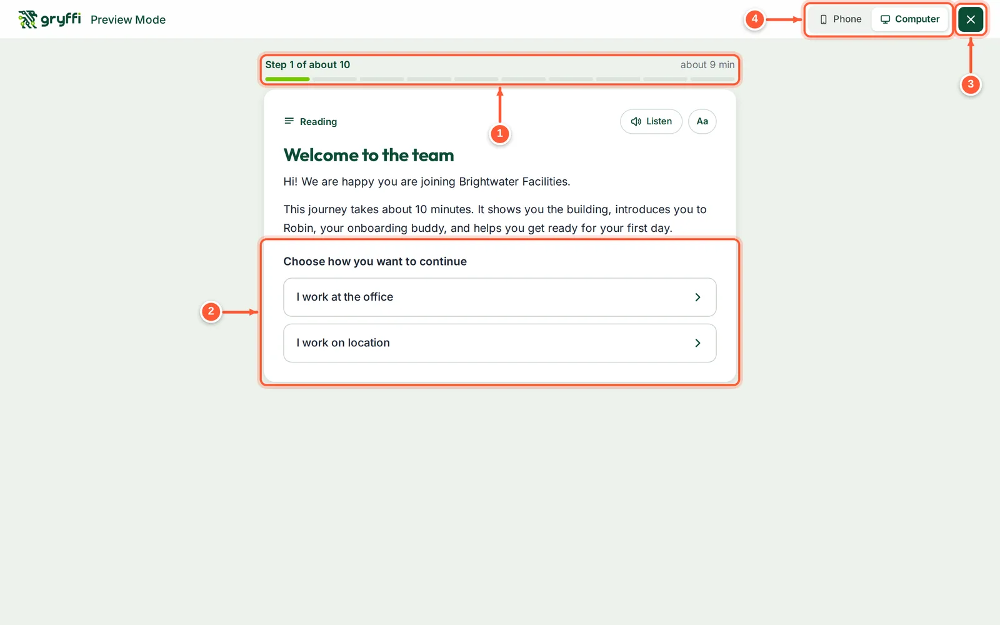

# Journey Preview

Journey Preview allows you to experience your journey exactly as participants will see it before publishing.

1. Step X of Y and the blocks above the step show how far you are in the journey.
2. The buttons take you to the next step, as they would for a participant.
3. Close the preview and go back to the builder.
4. **Phone** and **Computer**: see the journey as participants see it on that device.

## Overview

Preview enables:

- Testing journey flow
- Verifying content display
- Checking step behavior
- Checking the layout on a phone and on a computer
- Checking what participants experience

## Starting Preview

### From Builder

1. Open journey in builder
2. Click **Preview** in the toolbar
3. The journey opens in Preview Mode, at the start step

To start somewhere else, select a step and click **Preview from this step** in its panel. A bar at the top then says that this is a partial test run, not the full journey.

### From the Journeys page

You can also start a preview from the Journeys page. Click the three dots on the journey and select **Preview**. The preview starts at the start step.

## Preview Features

### Navigation

- Navigate through steps with the buttons (2)
- Access all paths
- Above each step you see "Step X of about Y" with one block per step, as participants see it. On the first step it also says about how many minutes the journey takes.
- Click close (3) to leave the preview and go back to the builder

### Phone or computer

At the top of the preview, choose **Phone** or **Computer** (4) to see the journey as participants see it on that device. You build each step once: Gryffi picks the layout from the width of the screen.

- **Phone**: everything is below each other. The button to go to the next step stays at the bottom of the screen, also when a step is longer than the screen.
- **Computer**: a photo, 360° photo or video sits next to the text, so the step fits on one screen. Steps with only text, a quiz, a form or a poll stay in one column.

Gryffi remembers your choice on this device. When you open the preview on a phone, you already see the phone layout and the buttons are hidden.

### Interactions

Test all interactive elements:
- Form inputs
- Quiz questions
- Poll voting
- Button clicks
- Navigation choices
- **Listen** (read aloud) and the dyslexia-friendly font (Aa)

### Language Testing

Preview mode follows your journey language settings:
- If you chose a different language for the journey, the preview shows that language
- If you chose a different language for the guide, the AI guide answers in that language
- This allows you to check the language before publishing

To test different languages:
1. Set the language in Journey Settings
2. Start Preview mode
3. Check that the interface elements show correctly
4. Test the AI guide's answers in the selected language

See: journey-settings, language-settings

## Preview vs Production

### Differences

| Aspect | Preview | Production |
|--------|---------|------------|
| Data saved | No | Yes |
| Analytics | No | Yes |
| Rewards given | No | Yes |
| Progress persisted | No | Yes |
| Form notification email sent | Yes | Yes |
| Automation emails sent | Yes, to you | Yes, to the participant |

When you submit a Form Step in preview, the notification email is sent to the configured recipient so you can check it. Preview submissions are not stored in Analytics.

When you click **Preview**, the journey's email automations run as they would for a participant, and the emails go to you. **Preview from this step** skips the "When journey starts" automations. Viewers get no automation emails from the preview.

See: form-step, form-submissions

## Participant Perspective

Consider:
- Is flow clear?
- Is content readable?
- Are instructions helpful?
- Is timing appropriate?

## Troubleshooting

### Preview Not Loading

- Check that the builder shows "All changes saved"
- Reload the page
- Clear browser cache
- Try different browser

### Content Missing

- Wait until the builder shows "All changes saved"
- Close and open the preview again
- Check step settings

## Related Features

- See: journey-builder, journey-settings, step-pacing
