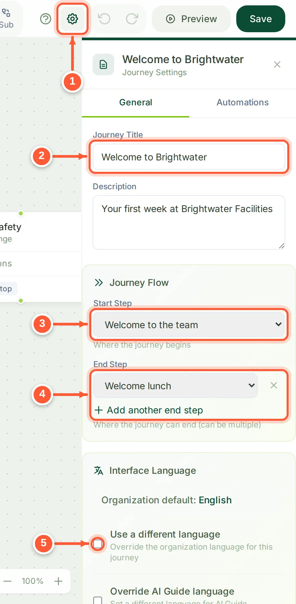

# Journey Settings

Journey Settings hold the settings of one journey: its title, flow, language and automatic emails.

1. The settings button in the toolbar of the builder opens the journey settings.
2. Journey Title.
3. Start Step: the step where the journey begins.
4. End Step: where the journey ends. Click + Add another end step for a second ending.
5. Use a different language: give this journey its own language for participants.

## Overview

The journey settings have two tabs:

- **General**: Journey Title, Description, Journey Flow (start and end steps) and Language for participants. At the bottom you see when the journey was created and last updated.
- **Automations**: Email Automations, automatic emails for journey-wide events, such as When journey starts, When journey completes and After inactivity.

[[goto:/dashboard/journeys]]

## Accessing Settings

1. Open a journey in the builder
2. Click the settings icon (gear) (1) in the toolbar at the top of the screen
3. Or click on empty space on the canvas

## General Settings

- Journey Title (2)
- Description
- Journey Flow
- Language for participants

### Renaming Wizard-Generated Journeys

Journeys created with the Journey Wizard get an AI-proposed title and a one-sentence description instead of a name you typed yourself. These are meant as suggestions. Open Journey Settings and update the **Journey Title** and **Description** fields to match your organization's wording. This has no impact on the generated steps, only on the title and description of the journey.

See: journey-wizard

### Journey Flow

Set a "Start Step" (3) and an "End Step" (4). Every journey needs a Start Step and at least one End Step. Without them you cannot publish the journey. You can add more than one End Step with **Add another end step**, so your journey can end in more than one way.

## Language for Participants

These settings set the language participants see in this journey. The section shows the organization default language first.

### Journey Language

By default, participants see the interface of the journey in your organization default language. You can choose another language for one journey:

1. In Journey Settings, find "Language for participants"
2. Turn on "Use a different language" (5)
3. Pick a language under "Journey language":
   - **Base languages**: English, Dutch, German, French, Spanish
   - **Extended languages**: Italian, Portuguese, Danish, Norwegian, Finnish, Swedish, Polish, Romanian, Turkish
4. The builder saves your change by itself

This changes all player interface elements, such as:
- Navigation buttons ("Continue", "Back", etc.)
- Form labels and validation messages
- Quiz feedback ("Correct!", "Try again", etc.)
- Poll voting interface
- Reward claim screens
- Pacing messages

It does not translate the content of your steps. Use Copy & Translate for that.

### Guide Language

You can set a separate language for the answers of the AI guide, independent of the journey language:

1. In Journey Settings, find "Language for participants"
2. Turn on "Use a different language for the guide"
3. Pick a language under "Guide language"
4. The builder saves your change by itself

When it is on:
- The guide's greeting is written in the selected language
- The guide answers in the selected language
- The interface elements stay in the journey language

If it is off, the guide uses the journey language.

**Use cases:**
- Journey interface in English, but the guide answers in Polish for Polish-speaking employees
- Test the guide's answers in different languages during preview
- Serve multilingual teams where the interface language differs from the preferred conversation language

### Fixed Opening Sentence

When "Use a different language for the guide" is on, you can also fill in a "Fixed opening sentence":

1. Turn on "Use a different language for the guide" first
2. Find the "Fixed opening sentence" field
3. Type the sentence the guide starts with
4. The builder saves your change by itself

**Benefits:**
- Loads right away, because the guide does not have to write an opening first
- The guide always starts with the same sentence
- Filled in for you when you use Copy & Translate

**Note:** This is optional. If you leave it empty, the guide writes its own opening in the selected language.

See: language-settings, ai-guides-overview, copy-translate

## Related Features

- [[goto:/dashboard/journeys]] - Journey list
- See: journey-builder, journey-preview, step-pacing, language-settings
