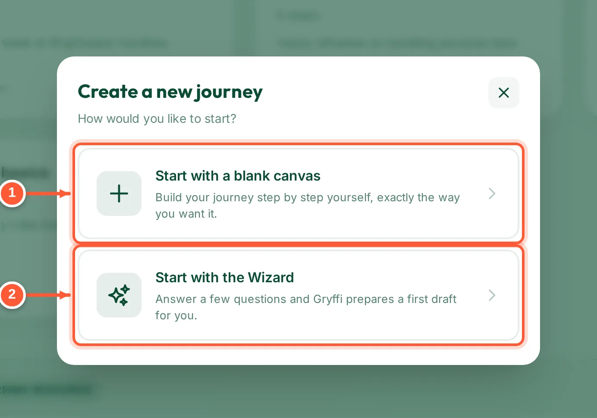
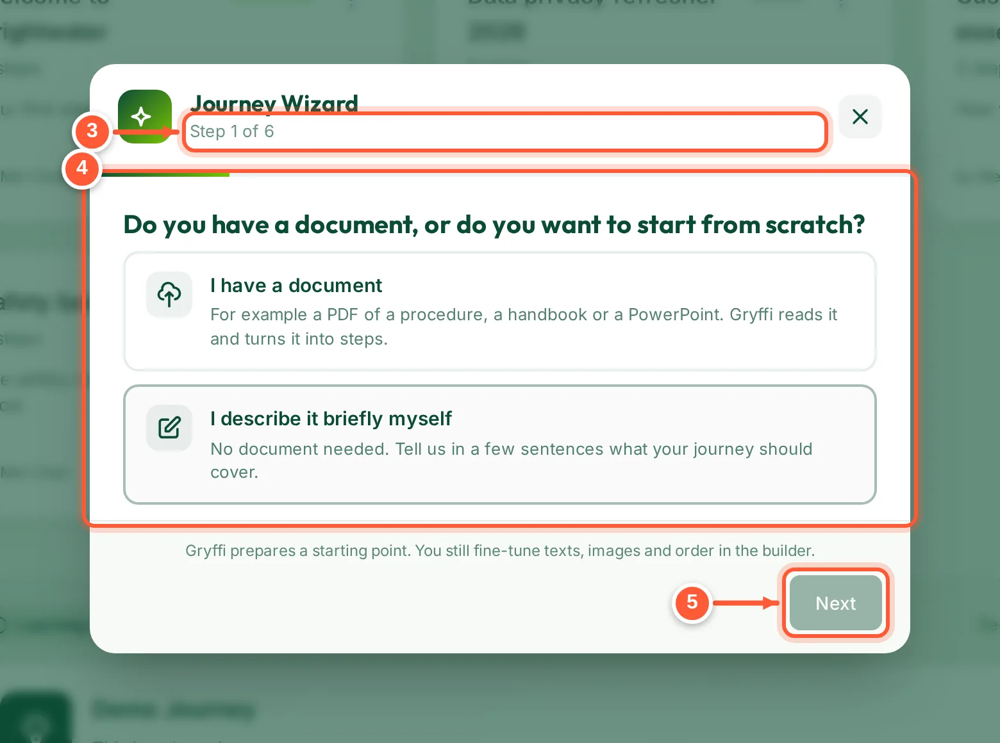

# Journey Wizard

The Journey Wizard is a guided, step-by-step flow that creates a first version of a journey for you, based on a short questionnaire. It is designed for non-technical makers who want a working starting point without having to build every step from scratch. After the wizard finishes, you can view the journey as a participant, send it to yourself, or open it in the Journey Builder to review it and add your own images.

A first version from the wizard is enough to test with. Send it to yourself and walk through it, then decide what to change. You can still change everything in the builder after publishing.

1. Start with a blank canvas: build the journey yourself, step by step.
2. Start with the Wizard: answer a few questions and Gryffi prepares a first draft.

3. Where you are in the wizard, for example Step 1 of 6.
4. Start from a document, such as a PDF of a procedure, or describe the journey in a few sentences.
5. Next: go to the next question.

## Overview

The Journey Wizard:

- Asks you a few simple questions, one per page
- Generates a journey draft (steps, links, texts) using AI
- Optionally creates or attaches an AI guide
- Optionally fills that AI guide's knowledge base with your uploaded document
- Lets you pick up your answers again if you close it by accident
- Saves the result as a **draft**, so nothing is visible to participants until you publish

[[goto:/dashboard/journeys]]

## How to Start the Wizard

1. Go to the Journeys list
2. Click **Create Journey**
3. A choice modal appears with two cards:
   - **Start with the Wizard** (2): opens the wizard
   - **Start with a blank canvas** (1): goes straight to an empty journey
4. Pick **Start with the Wizard**

The wizard opens as a modal on top of the journeys page.

Viewers cannot create journeys. For them the **Create Journey** button is greyed out.

## Picking Up Your Answers Again

If you close the wizard halfway, your answers are kept in this browser tab for 6 hours. When you open the wizard again, it asks "Continue where you left off?":

- **Continue**: the wizard opens at the first question, with your earlier answers filled in
- **Start fresh**: the wizard discards the previous answers

The answers are gone when you close the browser tab. An uploaded document is kept for 2 hours. After that, upload it again.

## The Wizard Pages

The wizard asks its questions in a fixed order, one per page. The step counter (3) shows where you are, for example Step 1 of 6. When you describe the journey yourself, there is one extra page. Click **Next** (5) to go to the next question, or **Back** to change an earlier answer. On the summary page every answer has a **Change** link.

### 1. Starting point: "Do you have a document, or do you want to start from scratch?"

Choose one of two starting points (4):

- **I have a document**: Upload a file and Gryffi reads it to build the journey around its content. Supported formats: PDF, Word (.doc/.docx), PowerPoint (.ppt/.pptx), Excel (.xls/.xlsx), plain text (.txt), Markdown (.md), CSV, and images (.png, .jpg, .webp, .gif). Limits: **50 MB** per file, **60 pages**. If your document is longer than 60 pages, only the first 60 pages are used and the wizard warns you.
- **I describe it briefly myself**: No document needed. You type a short description on the next page.

If the document reader is temporarily unavailable, the upload shows a message about it. Try again in a minute or describe the journey yourself.

### 2. Topic: "What should your journey be about?" *(only when you describe it yourself)*

A text box where you describe, in a few sentences, what the journey should cover. Type at least 30 characters so the AI has something to work with.

### 3. Purpose: "What will this journey be used for?"

Pick one of six purposes. The purpose steers the tone and the focus of the journey:

| Purpose | When to pick it |
|---------|-----------------|
| Onboarding new employees | Welcome, team info, first-week to-do's |
| Compliance or safety training | Rules, protocols and a knowledge check |
| Product or procedure training | Explain how a product or process works |
| Tour or location introduction | Show a workspace, office or facility |
| Knowledge sharing | Share internal know-how or customer information |
| Welcoming guests or visitors | Hotel guests, campsite visitors, event attendees or other people you host on location. The texts speak to the guest directly and focus on practical on-site information. |

On the same page you can fill in **Who is this journey for? (optional)**, for example "new warehouse staff" or "customers of our SaaS". It helps Gryffi match the tone of voice to your audience.

### 4. Length: "How long should your journey feel?"

Drag the slider. It has five stops: Very compact, Compact, Balanced (the default), Extensive and Very extensive. Gryffi picks the number of steps within a range that fits the stop and how much there is to cover in your material:

| Stop | Steps |
|------|-------|
| Very compact | 3 to 4 |
| Compact | 4 to 5 |
| Balanced | 5 to 7 |
| Extensive | 7 to 9 |
| Very extensive | 9 to 12 |

A long document can add one step to the range.

### 5. Building blocks: "What goes in your journey?"

Reading sections (content steps) are always added. Tick the extras you want:

- **Video**: a content step for a video. Paste your own YouTube link in the builder afterwards.
- **Image**: a content step with an image. Gryffi uses a free "Coming soon" placeholder you can swap out. Space steps also get this placeholder.
- **Knowledge check**: a quiz step.
- **Poll**: one opinion question, with no right or wrong answer.
- **Form**: a small form to collect a name, email or short answer.
- **AI guide**: a chat panel where participants can ask questions.
- **Location step**: a space step that introduces a place, room or venue.
- **Reward**: a closing gift.
- **Choice moment**: a question with two choices, so participants can take different routes.

You can leave everything unticked. Then the journey only has reading sections.

#### AI guide

When you tick **AI guide**, pick one of three options:

| Option | What it does |
|--------|--------------|
| Use one of my existing AI guides | Pick an AI guide you already set up. Greyed out when your organization has no AI guides yet. |
| Create a new AI guide from my document | Creates a new AI guide and loads your uploaded document into its knowledge base. Only available when you uploaded a document on the first page. |
| Create a new AI guide (I'll add documents later) | Creates an empty AI guide. You can add documents afterwards. This option is selected by default. |

For a new AI guide you type a name under **What should your new AI guide be called?**. The guide's greeting always uses exactly that name. **Next** stays greyed out until you picked a guide or typed a name.

#### Reward

When you tick **Reward**, pick one of four types:

| Option | What happens |
|--------|--------------|
| A voucher or discount code | Adds a closing reward step framed as a voucher. You add the code in the builder. |
| A completion certificate | Adds a closing reward step framed as a certificate. |
| A simple thank-you message | Adds a closing reward step with a thank-you tone. |
| Add a reward step (I'll fill it in later) | Adds an empty reward step for you to fill in later. |

Without a reward, the journey ends with a simple closing step. Under **Anything to add about the reward? (optional)** you can type extra context, for example "a 10% discount for our own webshop". The AI uses it to phrase the reward step. It never invents real codes, dates or URLs.

#### Choice moment

When you tick **Choice moment**, a slider asks "How adventurous may the routes be?":

| Stop | What you get |
|------|--------------|
| Subtle | One choice moment, paths merge again right away |
| Variation | One choice moment, each path gets a step or two of its own before merging |
| Separate routes (default) | One choice moment with different routes a few steps long. Routes merge at the end. |
| Adventure | Two choice moments spread through the journey. Routes stay largely separate. |
| Open ending | Several choice moments. Routes don't have to merge. Different endings are fine. |

At a choice moment, a content step asks a short question. The participant picks an answer by clicking one of the buttons. The button texts spell out the answers.

### 6. Language: "In which language should the journey be written?"

Defaults to your own interface language. You can pick any of the 14 languages Gryffi supports for participants:

English, Dutch, German, French, Spanish, Italian, Portuguese, Danish, Norwegian, Finnish, Swedish, Polish, Romanian, Turkish.

All generated step content, titles, the guide greeting, button texts and the journey title are written in this language. You can translate the result later with Copy & Translate.

### 7. Summary: "Ready to build your journey?"

Before the journey is generated, a summary page lists every answer. Each answer except the name has a **Change** link that jumps back to that question. The summary also shows:

- The **name**: Gryffi picks a fitting name itself. You can rename it later in the builder.
- A note that the result is a starting point, not a finished journey.

Click **Build my journey** to start.

## The Journey Name

The wizard does not ask you to name the journey. The AI writes a short title and a one-sentence description, in the language you picked. You can rename the journey at any time in the Journey Settings.

## Progress and Completion

While generating, a progress window shows a status line that changes as Gryffi works:

1. **Reading**: Reading your document
2. **Thinking**: Designing the steps
3. **Creating**: Creating the journey
4. **Guide**: Creating or linking the AI guide (if chosen)
5. **Knowledge**: Reading your document into the new guide's knowledge base (if chosen)
6. **Steps**: Adding the steps
7. **Paths**: Linking the steps
8. **Finishing**: Almost done

Do not close the window while Gryffi is working. If you close it, Gryffi asks you to confirm first.

### Success

When the journey is ready, you see a green check and the message that a first version is enough to test. You then have these options:

- **View it as a participant**: opens the preview, so you see the journey the way a colleague will. Try **Listen** (read aloud) and the dyslexia-friendly font there as well.
- **Send it to yourself**: publishes the journey and emails you an invitation with a personal link, the same email a colleague gets. Only people you invite can open a published journey. This button is only there for makers with the role Admin or Journey Manager. See Invitations for the details.
- **Edit it in the builder first**: opens the new journey as a draft in the Journey Builder.

### Errors

If anything fails, the wizard shows an error page with two actions:

- **Try again**: Returns you to the summary so you can change an answer and retry.
- **Create a blank journey with this name instead**: Leaves the wizard and opens a new empty journey.

Common causes: network problems, a busy AI service, a document without readable text (a scanned PDF with no text layer), or the AI returning output Gryffi cannot use. Retrying usually works.

## What the Wizard Generates

The wizard produces a draft journey containing:

- A number of steps within the range of the length you picked
- Content steps as the backbone of the journey
- The extras you ticked: video, image, quiz, poll, form, AI guide, location or reward steps
- **Links** between all steps, including the choice moments if you asked for them
- A **title** and a one-sentence **description**

Defaults for specific step types the wizard creates:

- **Content steps** with a video have no video link yet. Content steps with an image get the "Coming soon" placeholder.
- **Form steps** are pre-filled with your own email address as the recipient, so you get the responses by email right away. You can change the recipient in the step settings.
- **AI guide steps** copy the real guide's name, role and greeting into the step so nothing can go out of sync.
- **Reward steps** give every participant a random code. Terms and validity are yours to fill in. Want to hand out your own codes? Switch the step to custom codes and add them.

## What the Wizard Does NOT Do

The wizard leaves a lot of things up to the maker:

- It does **not** upload your own images or videos. Replace the placeholders in the builder.
- It does **not** invent real discount codes, certificate URLs, voucher values or dates.
- It does **not** publish the journey, unless you click **Send it to yourself** at the end.
- It does **not** send invitations to participants.
- It does **not** create Space steps with a floor plan or 360° panorama. Add those manually.
- It does **not** add your document to an existing AI guide's knowledge base when you pick "Use one of my existing AI guides". In that case the document is only used to write the journey.

## Role Limits

- Viewers cannot create journeys, so the **Create Journey** button is greyed out for them.
- Only makers with the role Admin or Journey Manager see **Send it to yourself**.

## Document Reading Notes

The document you upload is sent to Gryffi's document reader to get the text out:

- PDF, Word and PowerPoint are read with a fast method that skips text recognition on images (OCR).
- Scanned PDFs with no text layer may give very little text. If you see "We couldn't read any text from this document", export the document again or describe the journey yourself.
- The file is deleted after the journey is generated, unless you chose "Create a new AI guide from my document". In that case the file is kept as a knowledge source on the new AI guide and can be managed from the guide's knowledge base page.

## After the Wizard: Editing the Result

Once you are in the builder:

1. **Review every step**: The AI is good, but not perfect. Read the generated text and adjust facts, tone and length.
2. **Rename the journey** if the AI's suggestion does not fit. Click empty canvas → Journey Settings → Journey Title.
3. **Replace placeholders**: Add your own YouTube link to video steps and your own images to image and space steps.
4. **Set up reward details**: Add your own voucher codes if you have them, certificate text or redemption instructions in the reward step.
5. **Check form recipients**: The wizard sends form responses to your own email address. Change this in the form step settings if another person should receive them.
6. **Publish** the journey when everything looks right.

## Tips

- **Short documents work best**: A focused 5 to 20 page document gives a tighter journey than a 60-page handbook.
- **Be specific in the audience field**: "newly hired warehouse operators" leads to different wording than "our customers".
- **Describe abstract topics yourself**: If your content is not really in a document yet, typing a description often gives a cleaner result than uploading an unrelated file.
- **Keep the guide name short and human**: It appears in the chat bubble. Long names look awkward.
- **Use Copy & Translate after**: Build one journey with the wizard in your main language, then translate the finished version into other languages with Copy & Translate.

## Troubleshooting

### The Next button stays greyed out

Each page has at least one required answer. On the first page you need to either upload a document successfully or pick "I describe it briefly myself". On the building blocks page, a ticked AI guide needs a name for a new guide or a selected existing guide.

### My document was uploaded but the Next button stays greyed out

Wait for the "Document ready" confirmation before clicking Next. If the button stays greyed out, click **Choose a different file** and try again.

### We couldn't read this file

The document reader could not get any text out of the file. Most common causes:

- The PDF is an image scan without a text layer
- The file is password-protected
- The document reader is temporarily unavailable: try again in a minute

### Generation fails halfway

The AI sometimes returns output Gryffi cannot use, or takes too long. Click **Try again** on the error screen. A less extensive length can help. If it keeps failing, use **Create a blank journey with this name instead** and add a few steps yourself.

### The AI guide's greeting mentions a different name than the one I gave

The wizard corrects the name in the greeting to the name you typed. If you still see another name, reload the journey. The builder may be showing an older version.

### I want more choice moments

Pick Adventure or Open ending on the choice moment slider. Or open the journey in the builder and add more links yourself. The builder supports any shape.

## Related Features

- [[goto:/dashboard/journeys]] - Journey list
- See: journey-builder, journey-settings, journey-preview, invitations-overview, ai-guides-overview, guide-knowledge-base, guide-step, content-step, challenge-step, form-step, poll-step, reward-step, copy-translate, language-settings
