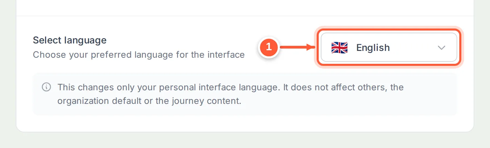

# Language Settings

Language Settings control the interface, email and PDF languages available throughout Gryffi.

1. Select language: the language of your own interface. It does not change the language of others or of journeys.

## Overview

There are several language settings that control different parts of the platform:
1. The organization default language
2. The makers personal interface language
3. Journey-specific language overrides (for participants)
4. AI Guide language overrides

[[goto:/dashboard/settings]]

## Supported Languages

Gryffi supports two categories of languages:

### Base Languages (Full Support)

These languages are available for the entire platform including the maker interface, emails, and PDFs:

| Language | Code | Maker Interface | Journey Player | Emails & PDFs |
|----------|:----:|:---------------:|:--------------:|:-------------:|
| English | en | Yes | Yes | Yes |
| Dutch (Nederlands) | nl | Yes | Yes | Yes |
| German (Deutsch) | de | Yes | Yes | Yes |
| French (Français) | fr | Yes | Yes | Yes |
| Spanish (Español) | es | Yes | Yes | Yes |

### Extended Languages (Journey Player Only)

These additional languages are available for participant journey experiences. They can be selected as journey language override or AI Guide language override:

| Language | Code | Journey Player |
|----------|:----:|:--------------:|
| Italian (Italiano) | it | Yes |
| Portuguese (Português) | pt | Yes |
| Danish (Dansk) | da | Yes |
| Norwegian (Norsk) | no | Yes |
| Finnish (Suomi) | fi | Yes |
| Swedish (Svenska) | sv | Yes |
| Polish (Polski) | pl | Yes |
| Romanian (Română) | ro | Yes |
| Turkish (Türkçe) | tr | Yes |

Extended languages affect:
- Journey player interface (buttons, messages, navigation)
- AI Guide responses (when AI Guide language override is set)
- Quiz, poll, form, and reward step interfaces

## Language settings

### Organization Language

Only a maker with the role Admin can make changes to the Default organization language.

Set organization default:
1. Go to Organization → General
2. Go to the optie "Default organization language" and select "Use one language for the whole organization
3. Select the language from the drop down menu
4. Click Save

This effects the journeys interface (not the journeys content), the automated emails and the downloadable PDFs for all maker and participants.

### Makers Personal Language

Set personal interface language:
1. Go to My account → Language
2. Select your language in **Select language** (1)
3. Save

This only affects the interface of the maker setting this language. No content or other makers or participants are effected.

## Journey Language Overrides

You can override the language settings for individual journeys. This is useful when you need to deliver content to participants in a different language than your organization default.

### Journey Interface Language

Override the interface language for a specific journey:
1. Open the journey in the builder
2. Click on the canvas background to open Journey Settings
3. Enable "Use a different language"
4. Select the desired language (base or extended)
5. The builder saves your change by itself

This changes:
- Navigation buttons and messages
- Quiz, poll, form interfaces
- Reward step text
- All player interface elements

### AI Guide Language Override

You can set a separate language for AI Guide responses, independent of the journey interface language:
1. Open the journey in the builder
2. Click on the canvas background to open Journey Settings
3. Enable "Override AI Guide language"
4. Select the desired language for AI responses
5. The builder saves your change by itself

This is useful when:
- You want the interface in one language but AI responses in another
- Your AI Guide knowledge base is in a specific language
- You're serving multilingual audiences

See: journey-settings, ai-guides-overview

## Copy & Translate Journeys

If you need to create the same journey in multiple languages, use the **Copy & Translate** feature instead of manually translating:

1. Go to the Journeys list
2. Click the **⋮** (kebab menu) on the journey you want to translate
3. Select **Copy to another language**
4. Choose the target language
5. Wait for AI translation to complete

This creates a new journey with:
- All content automatically translated
- Journey interface language override set
- AI Guide language override set
- AI Guide opening sentence translated

See: copy-translate

## Related Features

- [[goto:/dashboard/settings]] - Personal language settings
- [[goto:/dashboard/system-settings#general]] - Organization default language settings
- [[goto:/dashboard/journeys]] - Journey list with language settings
- See: organization-settings, journey-settings, ai-guides-overview
