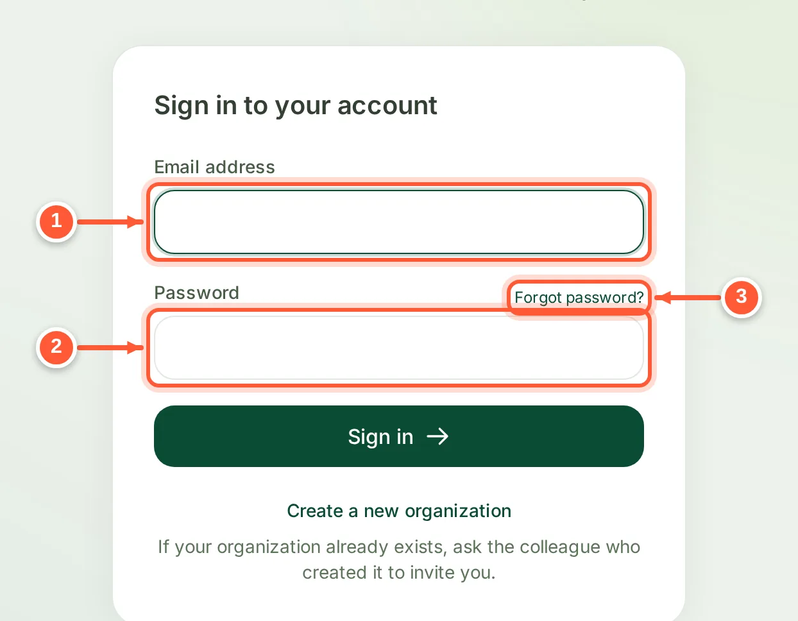

# Login

The Login page is where makers sign in to their Gryffi account.

1. Your email address.
2. Your password.
3. Forgot password: get an email with a link to set a new password.

## Overview

You sign in with your email address and password. Sometimes Gryffi also asks for a 6-digit code that it sends to your email address:

- Always, when you turned on two-factor authentication in My account.
- After 3 wrong passwords in 15 minutes.

[[goto:/login]]

## Login Form

Enter your email address (1) and your password (2). Click **Sign in**. Forgot your password? Click **Forgot password?** (3) to get an email with a link to set a new password.

| Field | Description |
|-------|-------------|
| **Email** | Your email address |
| **Password** | Your password |

## How long you stay signed in

You stay signed in while you use Gryffi. After 7 days without using Gryffi, you need to sign in again. On a shared computer, click **Sign out** (the button next to your name at the bottom of the menu).

## Verify your login

When Gryffi asks for a code, you see the page **Verify your login**.

1. Open the email from Gryffi.
2. Enter the 6-digit code.
3. Click **Verify**.

The code works for 10 minutes. No email? Click **Resend code**. You can ask for a new code 3 times. After 5 wrong codes, you go back to the login page and enter your password again.

## Troubleshooting

### "Invalid email or password."
- Check your email address.
- Check that Caps Lock is off. Passwords are case-sensitive.
- Not sure about your password? Click **Forgot password?**.

### "Too many failed attempts. Please wait ... seconds."
After 3 wrong passwords in 15 minutes, you wait 30 seconds. After 5 wrong passwords, you wait 5 minutes. The page counts down. Then try again, or reset your password.

### "Your account is temporarily locked."
After 10 wrong passwords, your account is locked for 30 minutes. The message says how many minutes are left. Wait, then sign in with the right password. A new password through **Forgot password?** also helps you after the lock ends.

### "Your account has been deactivated."
An admin of your organization turned off your account. Ask an admin to turn it on again.

### No code in your inbox
- Check your spam folder.
- Click **Resend code**.

## Related Features

- [[goto:/forgot-password]] - Reset password
- See: authentication, password-management, two-factor-authentication
