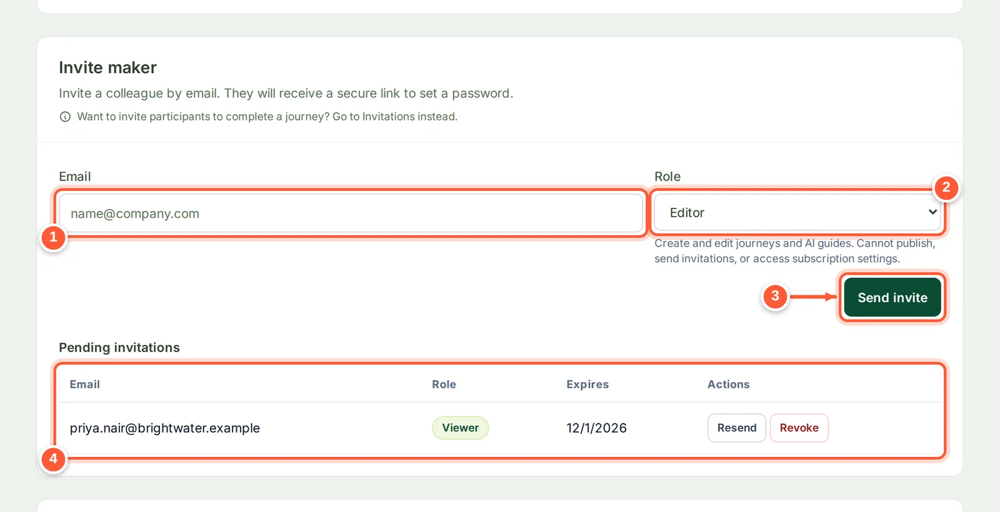

# Maker Invitations

Admins invite new makers to your organization in Gryffi. Only admins can send, resend or revoke maker invitations.

1. The email address of your colleague.
2. The role: Admin, Journey Manager, Editor or Viewer.
3. Send invite: your colleague gets an email with a link to set a password.
4. Pending invitations. Resend the email or Revoke the invitation.

## Overview

Invite makers so they can:

- Build journeys and AI guides
- Work in the Gryffi dashboard
- Work together with you

Want to invite participants to a journey? Use **Invitations** in the sidebar instead.

[[goto:/dashboard/team]]

## Sending Invitations

### Step 1: Open Makers

Go to **Makers** in the sidebar. Find **Invite maker**.

### Step 2: Enter Details

Enter the email address of your colleague (1) and choose a role (2). Below the role you see what that role can do.

| Field | Description |
|-------|-------------|
| Email | The email address of your colleague |
| Role | What your colleague can do in Gryffi |

### Step 3: Send

Click **Send invite** (3).

## Invitation Email

The email contains:
- The name of your organization
- Who invited them
- The role
- The button **Accept invitation**

The new maker clicks the button, enters their first name, last name and a password, and clicks **Create account**.

## Managing Invitations

### View Pending

Under **Pending invitations** (4) you see:
- The email address
- The role
- The expiry date
- The buttons **Resend** and **Revoke**

### Actions

| Action | Description |
|--------|-------------|
| Resend | Sends a new email with a new link. The link works for 7 more days. |
| Revoke | Cancels the invitation. The link stops working. |

To give a pending invitation another role, invite the same email address again with the new role.

### Validity Period

An invitation is valid for 7 days.

### Expired Invitations

- The link no longer works.
- The invitation stays in the list, with "Expired on" and the date.
- Click **Resend** to send a new link. The old link stays invalid.

## Troubleshooting

### Not Received

- Check the spam folder.
- Check the email address.
- Click **Resend**.

### Can't Accept

- Check if the invitation is older than 7 days. Then ask an admin to click **Resend**.
- Check if the invitation was revoked. Then ask an admin for a new invitation.

## Related Features

- [[goto:/dashboard/team]] - Makers
- See: makers-management, maker-roles
