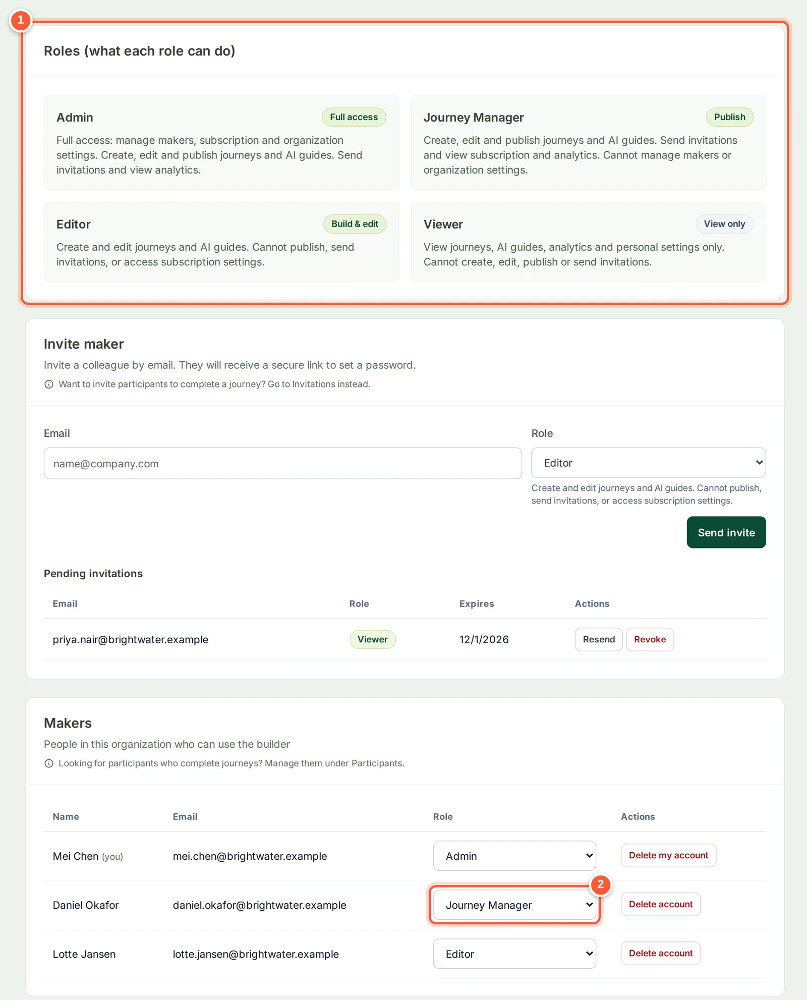

# Maker Roles

A maker role decides what a maker can do in Gryffi: build journeys, publish them, invite participants, manage makers or change settings.

1. What each role can do: Admin, Journey Manager, Editor and Viewer.
2. Change the role of a maker in the list of makers.

## Overview

Gryffi has four maker roles (1):

| Role | Main purpose |
|------|-----------------|
| **Admin** | Full control of the organization |
| **Journey Manager** | Publish journeys and invite participants |
| **Editor** | Build journeys and AI guides |
| **Viewer** | Look, but not change |

[[goto:/dashboard/team]]

Only an admin can change roles. Go to **Makers** in the sidebar and pick a new role for that maker in the list of makers (2). The change works within 30 seconds.

## What each role can do

| Permission | Admin | Journey Manager | Editor | Viewer |
|------------|:-----:|:---------------:|:------:|:------:|
| View journeys and AI guides | Yes | Yes | Yes | Yes |
| Create and edit journeys and AI guides | Yes | Yes | Yes | No |
| Publish journeys and take them offline | Yes | Yes | No | No |
| Move journeys and AI guides to the trash, restore them | Yes | Yes | No | No |
| Delete journeys for good from the trash | Yes | Yes | No | No |
| Delete AI guides for good from the trash | Yes | No | No | No |
| Send and revoke invitations to participants | Yes | Yes | No | No |
| Add participants, groups and directory links | Yes | No | No | No |
| Open Analytics, including Forms and Reports | Yes | Yes | Yes | Yes |
| Delete results of deleted journeys and steps, and archived polls | Yes | No | No | No |
| Invite makers and change roles | Yes | No | No | No |
| Organization page: settings, API key and themes | Yes | No | No | No |

Every maker can change their own settings in **My account**, and delete their own account.

## Which role to give

### Admin
Give to:
- Organization owners
- IT administrators

### Journey Manager
Give to:
- Team leads
- Training managers
- HR managers
- People who decide what participants get to see

### Editor
Give to:
- Content creators
- Instructional designers
- Colleagues who build journeys, but do not publish them

### Viewer
Give to:
- Stakeholders who want to follow the results
- Reviewers who check journeys before they are published
- External consultants

## Related Features

- [[goto:/dashboard/team]] - Manage roles
- See: admin-role, journeymanager-role, editor-role, viewer-role, makers-management
