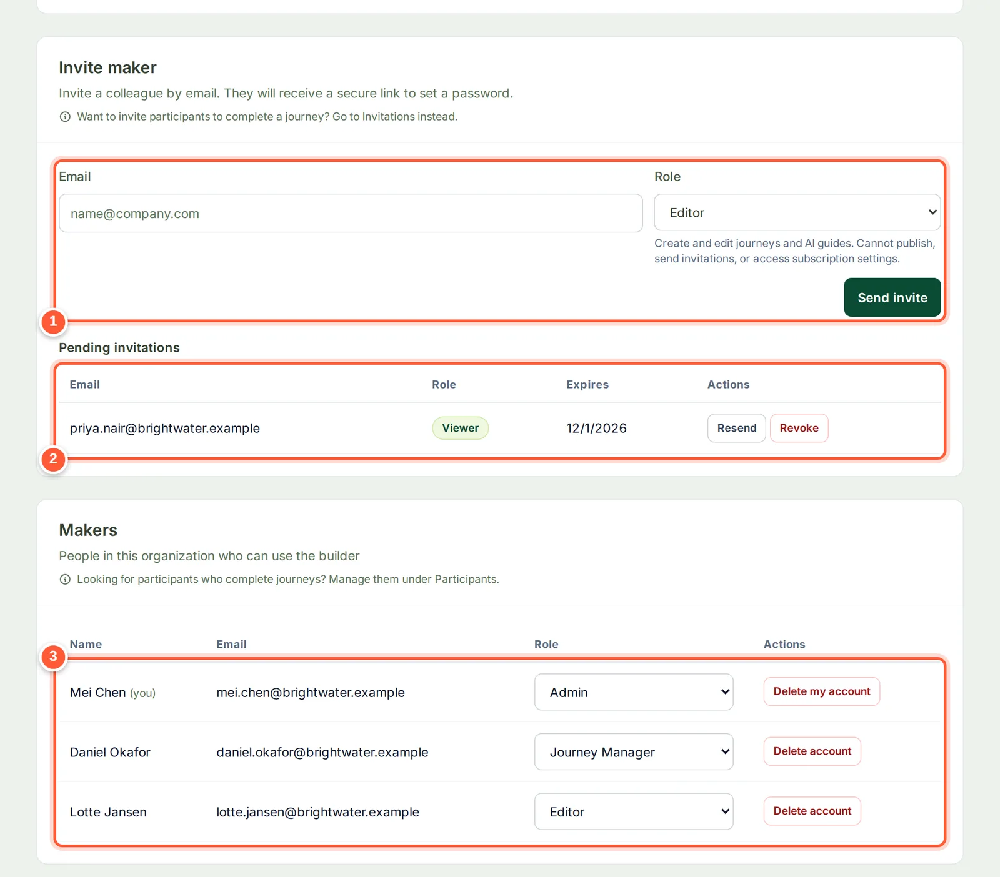

# Makers Management

On the **Makers** page, admins invite colleagues, give them a role and remove makers who no longer need access. The makers make the journeys. The participants follow the journeys.

1. Invite maker: the email address and role of a new colleague.
2. Pending invitations that have not been accepted yet.
3. The makers of your organization with their role.

## Overview

On the Makers page an admin can:

- Invite colleagues to your organization
- Give each maker a role
- Change the role of a maker
- Delete the account of a maker

[[goto:/dashboard/team]]

### Who sees the Makers page

- **Admin**: everything on this page.
- **Journey Manager**: the page is in the menu, but read-only. You see the roles and the list of makers. You cannot invite makers or change roles.
- **Editor**: the page is not in the menu. When an editor opens it, it is read-only, as for a Journey Manager.
- **Viewer**: no access.

## Makers vs Participants

| Makers | Participants |
|-----------------------|-----------|
| Build journeys | Follow journeys |
| Log in to the Gryffi dashboard | Open journeys with a personal link |
| Have a role | No role |

## Inviting Makers

### Send Invitation

1. Go to **Makers** in the sidebar.
2. Go to **Invite maker** (1).
3. Enter the email address.
4. Select a role: Admin, Journey Manager, Editor or Viewer.
5. Click **Send invite**.

### Invitation Process

1. Your colleague receives an email.
2. They click **Accept invitation**.
3. They enter their first name, last name and a password, and click **Create account**.
4. They now have access with the role you chose.

### Pending Invitations

Under **Pending invitations** (2) you see each invitation with its email address, role and expiry date. You can:
- **Resend** the invitation
- **Revoke** the invitation

To change the role of a pending invitation, invite the same email address again with the new role. The new invitation replaces the old one.

See: maker-invitations

## Roles and Permissions

| Role | Summary |
|------|---------|
| **Admin** | Full access: makers, participants and organization settings |
| **Journey Manager** | Create, edit and publish journeys and AI guides, send invitations |
| **Editor** | Create and edit journeys and AI guides |
| **Viewer** | View journeys, AI guides and analytics |

All roles can open Analytics.

See: maker-roles

### Changing Roles

1. Find the maker in the list of makers (3).
2. Choose a new role in the dropdown.

The change takes effect within 30 seconds. An organization always keeps at least one admin. Are you the only admin? Then give another maker the admin role first, before you change your own role.

## Managing Makers

### Actions in the list of makers

| Action | Description |
|--------|-------------|
| **Role** | Change the role of a maker (admins only) |
| **Delete account** | Delete the account of another maker for good (admins only) |
| **Delete my account** | Delete your own account. Every maker can do this. |

Deleting an account cannot be undone. The journeys and other content of that maker stay. The last admin cannot be deleted.

[[goto:/dashboard/team]]

## Best Practices

### Role Assignment
- Start with the role that has the fewest rights the person needs.
- Give a higher role when responsibilities grow.
- Keep a note of who has which role and why.

### Security
- Delete the accounts of colleagues who leave.
- Check the list of makers regularly.
- Turn on two-factor authentication for admin accounts in **My account**.

## Troubleshooting

### "Cannot Send Invitation"
- Check the email address.
- Check if the person is already a maker in your organization.

### "Maker Cannot Accept Invitation"
- Check that the invitation email arrived. Look in the spam folder.
- Check that the email address is correct.
- The link works for 7 days. Click **Resend** for a new link.

## Related Features

- [[goto:/dashboard/team]] - Makers
- See: maker-roles, maker-invitations, admin-role, two-factor-authentication
