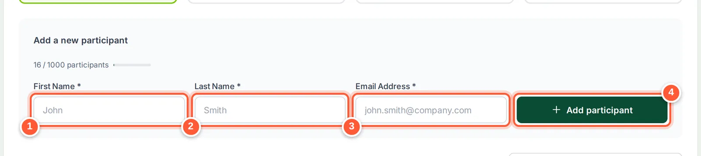

# Manual Participant Entry

Manual Participant Entry allows you to add individual participants to your organization one at a time.

1. First Name.
2. Last Name.
3. Email Address: the address the invitation goes to.
4. Add participant: the participant appears in the list below.

## Overview

Manually add:

- Individual participants
- First name, last name, email address
- Group assignment

[[goto:/dashboard/participants#users/manual]]

## Adding a Participant

### Fill in the form

1. Go to Participants - Manual Entry
2. Fill in: First Name (1), Last Name (2), Email Address (3)
3. Click "Add participant" (4)

## Group Assignment

### Add participants to a group

1. Go to Participants - Manual Entry
2. Scroll down to Groups
3. Press the members icon behind a group to add participant members

## Best Practices

- Verify email before entry
- Assign relevant groups
- Consistent data entry
- Use CSV/Excel import for bulk
- If you want to stay up to date, consider using a live sync with Microsoft 365 or Google Workspace
- Use our API to manage participants from your own automation scripts or tools

## Related Features

- [[goto:/dashboard/participants#users/manual]] - Manage participants
- [[goto:/dashboard/participants#users/manual]] - Add a participant
- See: end-user-management, csv-import
