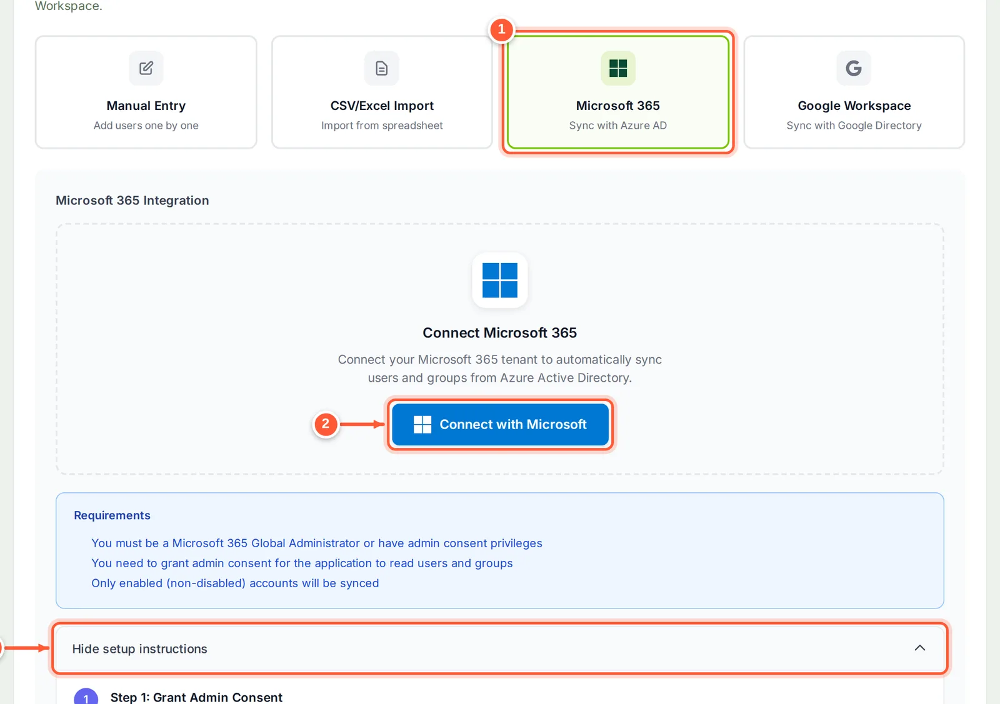

# Microsoft 365 Sync

Microsoft 365 Sync automatically imports and keeps your participants synchronized with your Microsoft 365 directory.

1. Microsoft 365: sync participants and groups from Microsoft 365.
2. Connect with Microsoft: a Microsoft 365 administrator gives Gryffi access.
3. Show or hide the setup instructions.

## Overview

With Microsoft 365 Sync, you can:

- Automatically import users from Microsoft 365
- Keep user data synchronized
- Import Microsoft 365 groups as participant groups
- Spend less time on adding and removing participants by hand

## Prerequisites

Before connecting:

1. **Global Administrator** or **Privileged Role Administrator** role in Microsoft Entra ID, to grant admin consent
2. **Admin role** in Gryffi organization

In the Community Edition, an admin first registers an app in Microsoft Entra. Then the admin enters its Microsoft application (client) ID and Microsoft client secret on the Installation page, section Integrations. Until then, the Participants page shows "Microsoft 365 link not set up".

## Connecting Microsoft 365

### Setup your Microsoft environment first

Setup instructions (3). You can show or hide them on the Microsoft 365 settings page:

1. Grant Admin Consent
When you click Connect, you will be redirected to Microsoft to grant admin consent for your organization. This allows Gryffi to read users and groups.

2. Sign in as Administrator
Sign in with a Microsoft 365 Global Administrator account or an account with permissions to grant admin consent.

3. Accept Permissions
Review and accept the requested permissions: User.Read.All (read all users), Group.Read.All (read all groups), and GroupMember.Read.All (read group memberships).

Important:
Only a Global Administrator or Privileged Role Administrator can grant admin consent. If you're not the admin, please share this page with them.

### Step 1: Navigate to Sync Settings

Go to Participants → **Microsoft 365** (1).

[[goto:/dashboard/participants#users/microsoft]]

### Step 2: Click "Connect with Microsoft"
Click **Connect with Microsoft** (2). You'll be redirected to Microsoft login.

### Step 3: Sign In
Log in with your Microsoft 365 administrator account.

### Step 4: Choose What to Import
After connecting, choose what to import under **What to import**. Then click **Save**.

## Sync Configuration

### Which users to import

| Option | Description |
|--------|-------------|
| **Import all users** | Import all enabled users from your Microsoft 365 organization |
| **Import specific groups only** | Import only users that are members of selected groups |

Only enabled (non-disabled) accounts are imported. Members of a nested group (a group inside a selected group) are not included. Select the nested group itself if you need its members.

### Groups

| Option | Description |
|--------|-------------|
| **Also import groups as participant groups** | Import groups and who is in them, along with the users |
| **Also import members of selected groups as users** | Users from selected groups are added to your participants list |

Synced groups get the source Microsoft. Every sync sets their members to the members in Microsoft 365.

See: end-user-groups

### Sync Schedule

Gryffi updates automatically every 15 minutes. Click **Update now** if you don't want to wait. The page shows the number of linked users and groups and the time of the last update.

## What a Sync Changes

Every sync:
- Adds new users
- Updates users that are already there
- Removes users you no longer include, for example a user who was disabled, deleted or is no longer in a selected group

Removing a participant also deletes their invitations, their progress in journeys and their form submissions. This cannot be undone.

### Safety limit

Gryffi does not remove anyone in a sync when:
- More than 3 people, and more than 10% of the synced participants, would be removed at once
- Part of the directory could not be read

New and changed users are still updated. When you click **Update now**, the message then says: "Some users were not removed for safety, because more than 10% would have been removed." Check your settings under What to import and your groups in Microsoft 365.

Participants from Microsoft 365 cannot be edited or deleted on the Participants page. Change them in Microsoft 365.

## Troubleshooting

### "Failed to connect to Microsoft 365"
- Verify admin permissions in Microsoft Entra ID
- Check if conditional access policies block the connection
- Try reconnecting with a different admin account

### Users Not Syncing
- Verify group selections include the users
- Check that the accounts are enabled in Microsoft 365
- Users in a nested group are not included: select that group itself
- Click **Update now** and read the message

### "Insufficient permissions" or "Access was denied"
- Connect again and grant admin consent
- Check in Microsoft Entra ID that the Gryffi app is still active

## Security Considerations

### Data Access
- Gryffi only reads user data, never writes to Microsoft 365
- No password data is transferred

### Revoking Access
To disconnect:
1. Go to Participants → Microsoft 365
2. Click **Disconnect**

Users and groups that were already imported stay in Gryffi, but they are no longer updated. The page then shows "Microsoft Users Without Connection" and "Microsoft Groups Without Connection". Connect again to keep them up to date, or click **Delete All** and **Delete Groups** to delete them.

## Related Features

- [[goto:/dashboard/participants#users/microsoft]] - Sync settings
- [[goto:/dashboard/participants#users/microsoft]] - View synced users

See: end-user-management, end-user-groups, google-workspace-sync
