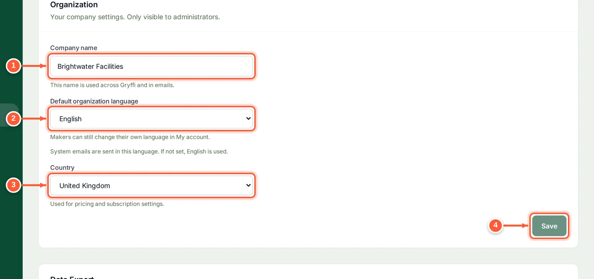

# Organization Settings

Organization settings are the settings for your whole organization, such as the company name and the default language. Only admins can change them.

1. Company name: shown across Gryffi.
2. Default organization language: one language for everyone, or each maker's browser language.
3. Country.
4. Save.

## Overview

Organization settings include:

- Company name
- Default organization language
- Country

[[goto:/dashboard/system-settings#general]]

## Company name

This name is used across Gryffi and in emails.

## Default organization language

Choose one language for the whole organization:
- English
- Dutch (Nederlands)
- German (Deutsch)
- French (Français)
- Spanish (Español)

Or choose **Use each maker's browser language**.

The default language is used for:
- The interface of makers, until they choose their own language in My account.
- System emails. If no language is set, Gryffi uses English.
- Journeys, unless a journey has its own language.

See: language-settings

## Accessing Settings

Only the **Admin** role can open the Organization page:

1. Go to Organization.
2. Select the **General** tab.
3. Change the company name (1), the default organization language (2) or the country (3).
4. Click **Save** (4).

The General tab also has **Data Export**: download all data of your organization as a ZIP file.

See: system-settings

## Related Features

- [[goto:/dashboard/system-settings#general]] - Organization
- See: makers-management, custom-themes, language-settings, system-settings
