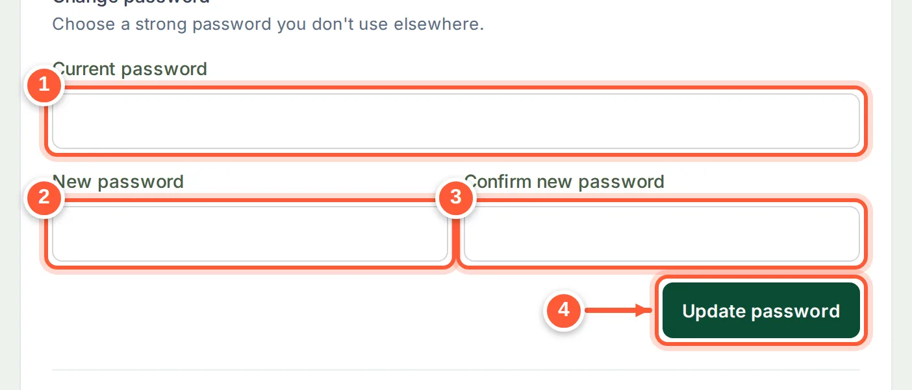

# Password Management

Password Management covers creating, changing, and securing your Gryffi account password.

1. Current password.
2. New password.
3. Confirm new password: type the new password again.
4. Update password.

## Overview

Manage your password:

- Create strong passwords
- Change password regularly
- Reset if forgotten
- Security best practices

[[goto:/dashboard/settings]]

## Password Requirements

### Minimum Requirements

| Requirement | Standard |
|-------------|----------|
| Length | 8+ characters |
| Uppercase | At least 1 |
| Lowercase | At least 1 |
| Number | At least 1 |
| Special Character | At least 1 |

### Strong Password Tips

- Use 12+ characters
- Mix all character types
- Avoid common words
- Don't reuse passwords
- Use passphrase method

## Changing Password

### Steps

1. Go to My account → scroll down to the Security section
2. Click "Change Password"
3. Enter current password (1)
4. Enter new password (2)
5. Confirm new password (3)
6. Click **Update password** (4)

## Password Reset

### Forgotten Password

1. Go to login page
2. Click "Forgot Password"
3. Enter email
4. Check inbox
5. Click reset link
6. Create new password

See: password-reset

## Password Storage

### Security

- Passwords are hashed
- Never stored in plain text
- Cannot be retrieved
- Only reset available

### Your Responsibility

- Don't share passwords
- Don't write down
- Use password manager
- Unique per service

## Related Features

- [[goto:/dashboard/settings]] - Security settings
- See: authentication, password-reset, two-factor-authentication
