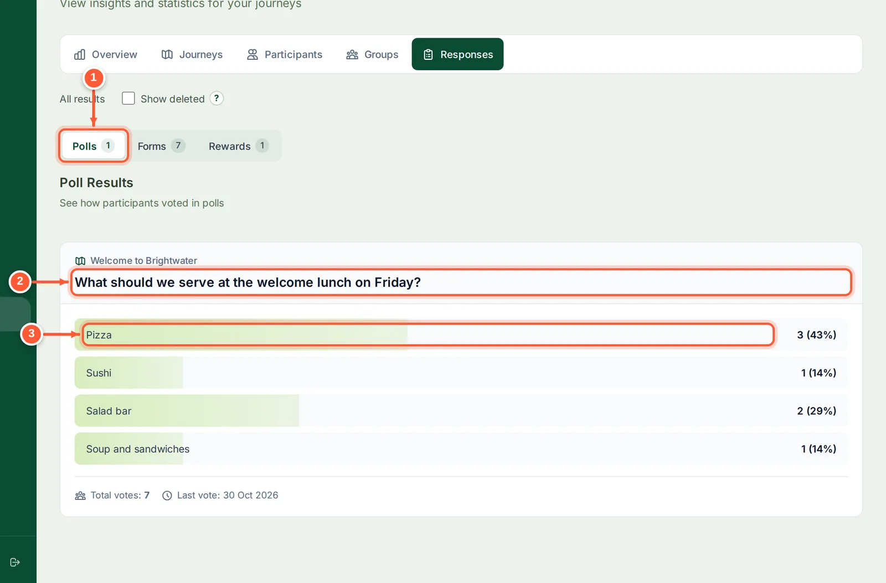

# Poll Results

Poll Results show the voting outcomes from Poll Steps in your journeys, providing insights into user preferences and opinions.

1. The Polls tab in Analytics.
2. A poll with its question and the journey it belongs to.
3. An answer with its number of votes and percentage.

## Overview

Poll results display:

- Vote counts per option
- Percentage distribution

[[goto:/dashboard/analytics#polls]]

## Viewing Results

### Access Poll Results

1. Go to Analytics → Polls (1)
2. Find the poll (2). It shows the question and the journey it belongs to
3. Each answer (3) shows its number of votes and percentage

### Results Display

| Metric | Description |
|--------|-------------|
| Total Votes | Number of users who voted |
| Distribution | Percentage per option |
| Bar Chart | Visual representation |

## Related Features

- [[goto:/dashboard/analytics#polls]] - View all polls
- [[goto:/dashboard/analytics#polls]] - Full analytics
- See: poll-step, reports
