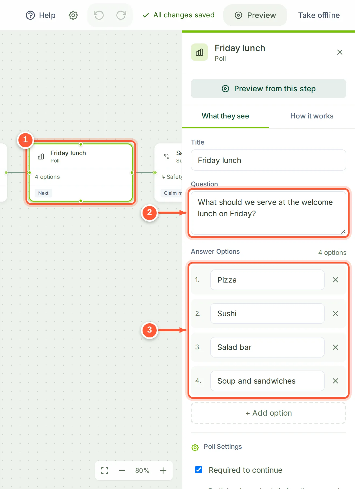

# Poll Step

The Poll Step asks participants one question and collects their vote. There is no right or wrong answer. After voting, participants see how everyone voted so far.

1. The Poll step on the canvas.
2. Question: the one question participants answer.
3. Answer Options: click + Add option for another option.

## Overview

Poll Steps are short, single-question surveys. Use them to:

- Ask participants for their opinion
- Show participants how others voted
- Collect votes you can compare in Analytics
- Break the ice at the start of a journey

## Properties

### What they see

Select the Poll step (1) on the canvas to open its settings.

| Property | Description |
|----------|-------------|
| **Title** | The title of the Poll Step |
| **Question** | The poll question |
| **Answer Options** | The answers participants choose from, at most 10 |
| **Required to continue** | On by default. Participants must vote before they can go to the next step. |
| **Allow multiple answers** | Participants can choose more than one answer |

Results are always shown to participants after they vote.

### Poll Question

Write a clear, short question in the **Question** field (2). Examples:

- "Which topic interests you most?"
- "How would you rate today's session?"
- "What should we serve at the welcome lunch?"

### Answer Options

Add the answers participants can choose under **Answer Options** (3):

1. Click **+ Add option**.
2. Type the option text.
3. Repeat for more options, up to 10.

Click the cross next to an option to remove it.

### How it works

On the **How it works** tab you find **Reset Poll**. Click **Reset all votes** to delete all votes, for example after testing. Gryffi asks you to confirm. The votes are deleted for good.

You can also add a guide to this step.

See: step-assistant

## Generated by the Journey Wizard

On the page "What goes in your journey?" of the Journey Wizard, tick **Poll** to add a Poll Step. The AI writes a simple question and 2 to 5 answer options based on your topic. Check the wording before you publish. Short, neutral wording works best for polls.

See: journey-wizard

## Related Features

- [[goto:/dashboard/analytics#polls]] - View poll results
- See: poll-results, journey-builder, journey-wizard
