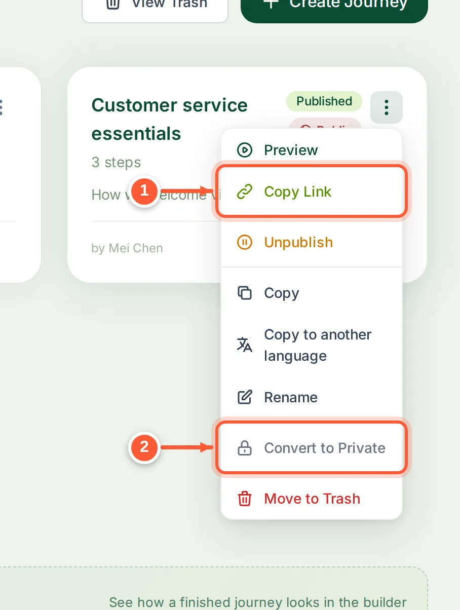

# Public Journeys

Public Journeys are accessible to anyone with the link. They are for linking on your website or intranet. The public journeys are for everyone to see. So don't make any journeys public that have sensative data in them.

1. Copy Link: copy the public link to share it.
2. Convert to Private: only invited participants can open the journey again.

## Overview

Public journeys enable:

- Open access
- Link sharing
- External audiences

## Setting Up Public Access

### Enable Public

1. Go to Journeys
2. Look for the journey you want to make public
3. Click on the three dots in the right corner of the journey card
4. Click "Convert to Public"
5. Read the warning carefully!

To make the journey private again, click **Convert to Private** (2) in the same menu. After that, only invited participants can open the journey.

### Public URL

Once public, the journey gets a public link. "Copy Link" only appears in the menu when the journey is also published: a draft has no link that works yet.

1. Go to Journeys
2. Look for the public journey
3. Click on the three dots in the right corner of the journey card
4. Click "Copy Link" (1)
5. The public link is now on your clipboard. Paste it where you want to share it

## Access Options

### Authentication

| Option | Description |
|--------|-------------|
| None | Anonymous access |
| Poll step | Public participant gets to authenticate to use the Public Poll Step |
| Form step | Public participant gets to authenticate to use the Public Form Step |
| Reward step | Public participant gets to authenticate to get the Public Reward |

## Sharing Public Journeys

### Share Link

Copy and share via:
- Website / Intranet
- Social media
- Messaging

## Best Practices

### Content Considerations

- Suitable for public audience
- No sensitive information
- Self-explanatory
- Professional presentation

## Related Features

- [[goto:/dashboard/journeys]] - Journey list
- See: public-journey-identification, journey-settings
