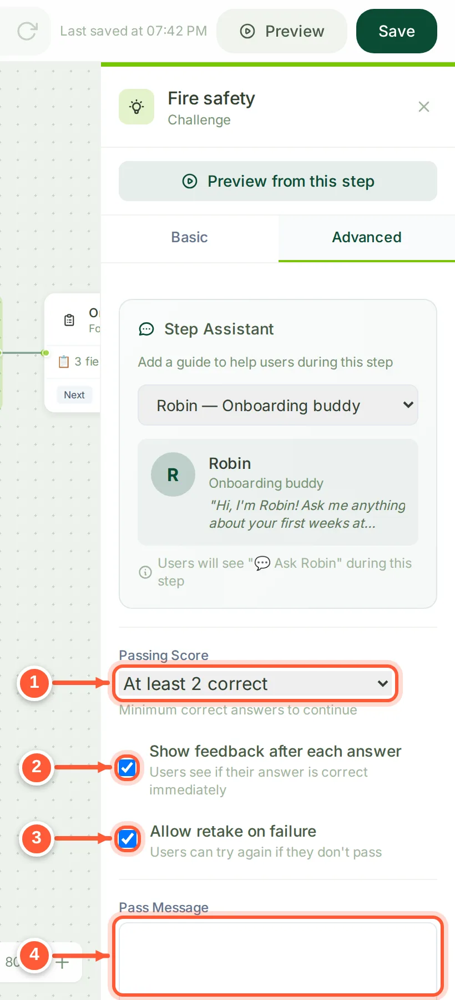

# Quiz Settings

Quiz settings control how a Quiz step works: the passing score, feedback, retakes and the messages after the quiz.

1. Passing Score: how many answers must be correct to continue.
2. Show feedback after each answer: participants see right away whether their answer is correct.
3. Allow retake on failure: participants can try again when they do not pass.
4. Pass Message: the text participants see when they pass.

## Overview

On the **What they see** tab:

- Title
- One or more multiple-choice questions
- Randomize question order (shows when the quiz has 2 or more questions)

On the **How it works** tab:

- Guide in this step
- Passing Score (1)
- Show feedback after each answer (2)
- Allow retake on failure (3)
- Pass Message (4)
- Fail Message

## Questions

Each question has 2 to 6 answer options. One option is the correct answer: the filled circle in front of it.

See: challenge-step

## Scoring

### Passing Score

**Passing Score** (1) sets how many answers must be correct to continue to the next step. Choose:

- **No requirement (always pass)**: the default
- **At least ... correct**: a number of correct answers
- **All questions**: every answer must be correct

### Retakes

**Allow retake on failure** (3) lets participants try the quiz again when they do not pass. It is on by default.

## Feedback

**Show feedback after each answer** (2) lets participants see right away if their answer is correct. It is on by default.

The **Pass Message** (4) and **Fail Message** are the texts participants see after the quiz.

## Question order

Turn on **Randomize question order** on the What they see tab. Each participant then sees the questions in a different random order.

## Related Features

- [[goto:/dashboard/journeys]] - Create quizzes
- See: challenge-step, analytics-overview
