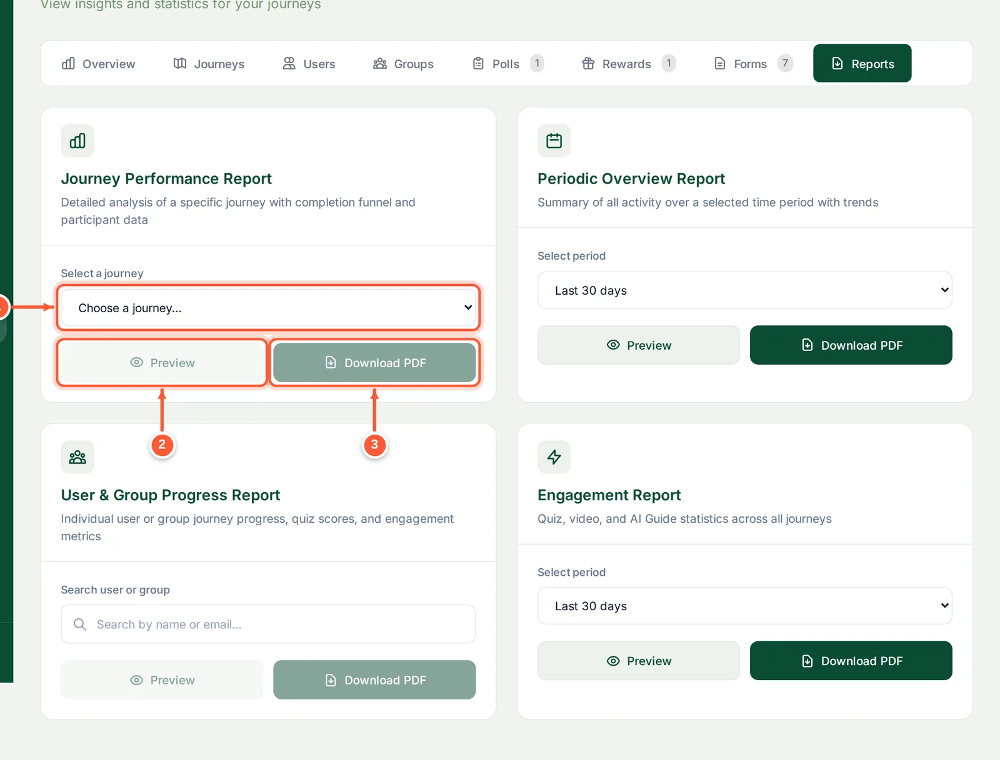

# Reports

Reports are PDF files about your journeys, participants, groups and engagement. You find them in Analytics, tab Reports.

1. Choose the journey for the Journey Performance Report.
2. Preview: see the report on screen.
3. Download PDF: save the report as a PDF.

## Overview

Four report types are available:

| Report | Description |
|--------|-------------|
| Journey Performance | Analysis of a specific journey with completion funnel |
| Periodic Overview | Summary of all activity over a time period |
| Participant & Group Progress | Detailed report for an individual participant or group |
| Engagement | Quiz, video and AI guide statistics |

[[goto:/dashboard/analytics#reports]]

## Report Types

### Journey Performance Report

Generate a detailed analysis for a specific journey.

**Report contents:**
- Invitations, completed, completion rate and average time to complete
- Completion funnel with step-by-step drop-off
- Poll results of the journey
- Participant list with name, email, status and completion date

**How to generate:**
1. Go to Analytics → Reports
2. Select a journey from the dropdown (1)
3. Click "Preview" (2) to see how the report will look
4. Click "Download PDF" (3) to save the report

### Periodic Overview Report

Get a summary of all organizational activity over a selected period.

**Report contents:**
- Invitations, completed, completion rate and average time
- New participants, total participants and poll responses
- Activity over time
- Top journeys
- A comparison with the previous period

**How to generate:**
1. Go to Analytics → Reports
2. Select a period: Last 7 days, Last 30 days, Last 90 days or Last 365 days
3. Click "Preview" to see how the report will look
4. Click "Download PDF" to save the report

### Participant & Group Progress Report

Track progress for individual participants or entire groups.

**Report contents for participants:**
- Participant information (email, group membership)
- Journey activity statistics
- Quiz performance (attempts, scores, pass rate)
- Video engagement data

**Report contents for groups:**
- Group information and member count
- Journeys started, journeys completed, completion rate and average quiz score
- Top performers

**How to generate:**
1. Go to Analytics → Reports
2. In the Participant & Group Progress card, use the search field
3. Type a name or email to search for participants or groups
4. Select a participant or group from the results
5. Click "Preview" to see how the report will look
6. Click "Download PDF" to save the report

### Engagement Report

See how participants use quizzes, videos and AI guides in all journeys.

**Report contents:**
- Quiz statistics (attempts, average score, pass rate)
- Most attempted quizzes
- Video statistics (views, average watched)
- Most watched videos
- AI guide statistics (chats, messages, average chat duration)
- Most active AI guide steps

**How to generate:**
1. Go to Analytics → Reports
2. Select a period: Last 7 days, Last 30 days, Last 90 days or Last 365 days
3. Click "Preview" to see how the report will look
4. Click "Download PDF" to save the report

## Preview Function

Every report has a **Preview** button. The preview shows the figures, charts and tables of the report on screen. Click **Download PDF** in the preview window to save the report.

The PDF can look slightly different from the preview. The PDF uses the logo and colors of your active theme and has page numbers. The preview always shows the Gryffi logo.

## Quick Export Buttons

You can also download a PDF from two other tabs in Analytics:

| Location | Action |
|----------|--------|
| Journeys tab | **Export PDF** next to the journey selector exports the selected journey |
| Participants tab | **Export PDF** in the participant details window exports the progress of that participant |

For a group report, use the Participant & Group Progress card on the Reports tab.

## PDF Customization

Reports use your organization's theme settings:

| Setting | Effect |
|---------|--------|
| Primary Color | Headers and accent colors |
| Logo | Appears in report header |

See: custom-themes

## Related Features

- [[goto:/dashboard/analytics#reports]] - View reports
- [[goto:/dashboard/analytics]] - Analytics dashboard
- See: analytics-overview, poll-results, end-user-management, end-user-groups
