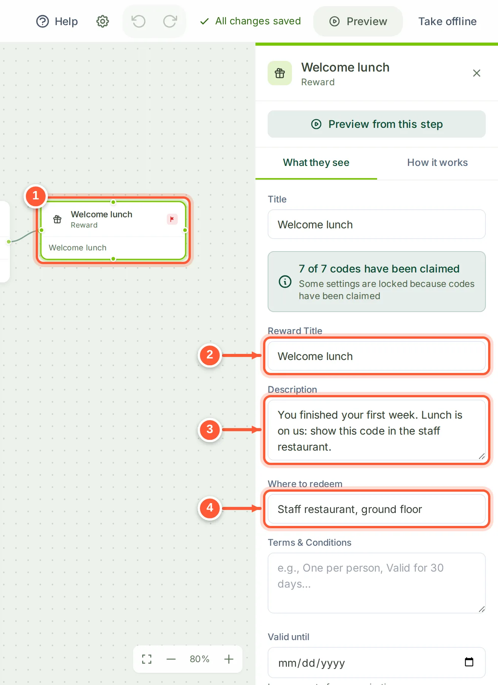
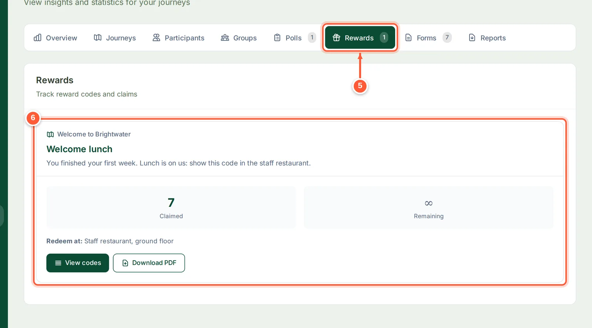

# Reward step

Reward Codes are the coupon codes, discount codes, or unique identifiers distributed through Reward Steps. The coupon codes are meant to be used in the real world. They are for getting participants more motivated to take journeys and finish them.

1. The Reward step on the canvas.
2. Reward Title: the name of the reward participants see.
3. Description: what the reward is and how to use it.
4. Where to redeem: where participants can use their code.

## Overview

Click the Reward step (1) on the canvas to open its settings. On the What they see tab of the reward step:

- Title - Title of the step
- Reward Title (2) - Title name for the reward coupon
- Description (3) - Description of the reward
- Where to redeem (4) - The place the participant can spend their reward code
- Terms & conditions - A good description of the rules around a given reward
- Valid until - A date in the future. The coupon must be used before that time
- Code settings - Set if you use custom codes or random codes
- Claimed codes - The codes already claimed by participants
- Add new codes - To add additional codes
- Maximum recipients - This number gives the first X participants that made it to the Reward Step a coupon code

With your own codes, each participant gets the next unused code from the list. A code you remove from the list is no longer handed out. When all codes are used or the maximum is reached, the next participant sees that all rewards have been handed out.

In a public journey, the participant first confirms their email address. Each email address gets one code, and a copy of the code is sent to that address.

## Analytics Reward Reports

5. The Rewards tab in Analytics.
6. A reward with the number of claimed and remaining codes, View codes and Download PDF.

In Analytics, open the Rewards tab (5).
For each reward (6), view code statistics and download a PDF.

Example: If you give codes for a free lunch at the staff canteen. You may want to give the PDF or a printed copy to the canteen worker, so they will know who to give a free lunch to.

## Added by the Journey Wizard

The Journey Wizard can append a Reward Step to a journey when you pick the **Extended (7 steps)** length. During the wizard you choose what type of reward fits the journey:

- **Voucher / coupon code**: the wizard creates a Reward Step with a short title and description, and random codes so every participant gets one. Add your own codes, the redemption location and the expiry date in the builder before publishing, if you have them.
- **Certificate of completion**: a simple thank-you reward with certificate-style wording.
- **Thank-you message**: a lightweight reward without codes, suitable for internal onboarding.
- **I'll configure it later**: adds an empty Reward Step that you configure yourself.

In every case the wizard only produces a draft. Open the Reward Step after generation to fill in the real-world details (codes, valid-until date, maximum recipients, terms). See: journey-wizard.

## Related Features

- [[goto:/dashboard/journeys]] - Reward step management
- [[goto:/dashboard/analytics#rewards]] - Reward analytics
- See: reward-step, reward-tracking, journey-wizard
