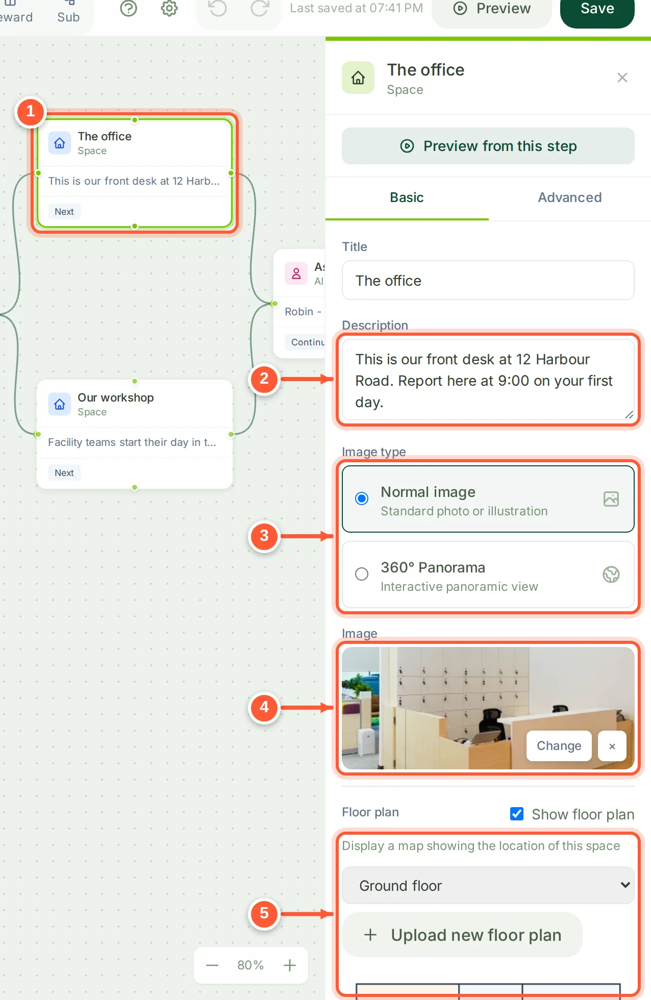

# Space Step

The Space Step represents a physical or virtual location in your journey. Use it to show a room, a building or a venue with a photo or a 360° panorama. You can add a floor plan that shows where the location is.

1. The Space step on the canvas.
2. Description: the text participants read with the image.
3. Image type: a normal image or a 360° panorama.
4. Image: click Change to choose another image.
5. Floor plan: tick Show floor plan, choose a floor plan and place the marker on the location.

## Overview

A Space step shows one of two image types:

- **Normal image**: a photo or illustration of the location
- **360° Panorama**: a spherical image that participants can drag to look around

On top of that, you can show a **floor plan** with a marker on the location of this step.

## Properties

### What they see

Select the Space step (1) on the canvas to open its settings.

| Property | Description |
|----------|-------------|
| **Title** | The name of the location (for example "Reception") |
| **Description** (2) | The text participants read with the image |
| **Image type** (3) | Normal image or 360° Panorama |
| **Image** (4) | The photo of the location. Click **Change** to choose another image. |
| **Floor plan** (5) | Optional: a map with a marker on the location of this step |

### Image type

Choose the image type (3) that fits your photo:

1. **Normal image**: a regular photo or illustration. You choose it in the Choose Image window.
2. **360° Panorama**: click **Upload 360° photo** and choose a JPEG or PNG file from your computer.

See: image-library

### Floor plan

The floor plan is an extra on top of the image:

- Tick **Show floor plan** (5) to show a map with the location of this step.
- **Select floor plan**: choose a floor plan that was already uploaded in your organization.
- **Upload new floor plan**: upload a new map.
- Click on the floor plan to place the marker. The hint under the map says **Click to place marker**.

See: floor-plans

### How it works

On the **How it works** tab you set:

- **Pacing**: when participants can continue. Choose Immediately, After 10 seconds, After 30 seconds or After 1 minute.
- **Guide in this step**: an AI guide that helps participants while they are on this step.

See: step-pacing, step-assistant

## Tips

### For panoramas

- Use an equirectangular 360° photo.
- Make sure the photo has good lighting and few stitching errors.
- Most smartphones can take 360° photos. On iPhone, use the 'Panorama' mode. On Android, use the 'Photo Sphere' or '360°' mode in your camera app.

### For floor plans

- Keep the floor plan simple and easy to read.
- Use clear labels for the different areas.
- Place the marker on the spot where this Space step is.

## Use Cases

- **Office tours**: show departments and facilities
- **Museum exhibits**: guide visitors through galleries
- **Real estate**: virtual property walkthroughs
- **Training**: show new colleagues around their workplace

## Generated by the Journey Wizard

The Journey Wizard can add Space steps when you tick **Location step**. The wizard writes a short description of the place. When you also tick **Image**, the Space step gets a placeholder image. Replace it with your own photo or panorama in the builder, and add a floor plan if you want one.

See: journey-wizard

## Related Features

- [[goto:/dashboard/journeys]] - Create a journey with Space Steps
- See: floor-plans, image-library, step-pacing, journey-wizard
