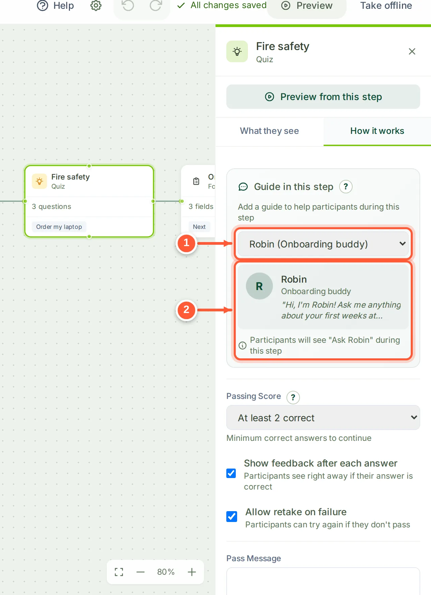

# Step Assistant

Step Assistant is the AI Guide added to another step than the Guide Step. It can help the end user with their journey, answering questions about the step they are in.

1. Step Assistant: choose the guide that helps end users during this step.
2. The chosen guide. End users see a button such as Ask Robin while they are on this step.

## Overview

Step assistants provide:

- Contextual help per step
- Quick question answering
- Guidance without leaving step

## How It Works

### User Experience

1. User reaches step
2. Sees the Ask John (name of the guide) button 
3. Clicks to open assistant
4. Asks questions
5. Gets contextual answers

## Enabling Step Assistant

### Per Step

1. Select step in builder
2. Go to Advanced tab
3. Click on the dropdown menu in the Step Assistant section (1)
4. Choose one of the AI Guides made on the Guides page
5. The chosen guide (2) helps end users during this step. They see a button such as Ask Robin while they are on this step

## Related Features

- [[goto:/dashboard/journeys]] - Journey builder
- See: ai-guides-overview, guide-step
