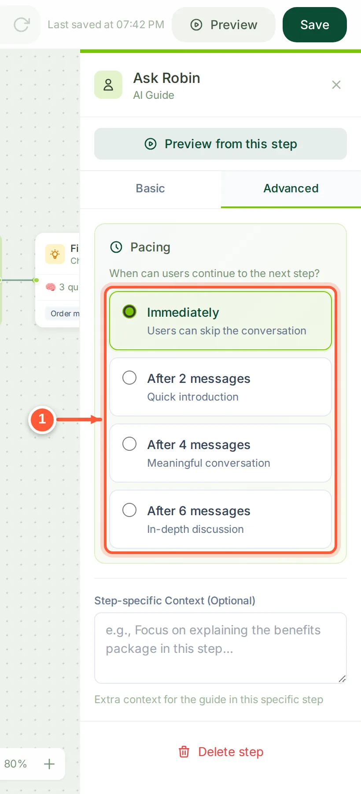

# Step Pacing

Pacing sets when participants can continue to the next step. Until then, the Continue buttons stay hidden and the step shows what the participant is waiting for.

1. Pacing: when participants can continue to the next step. Immediately, or after they sent 2, 4 or 6 messages to the guide.

## Where to set it

1. Select the step on the canvas.
2. Open the How it works tab.
3. Pick an option under "Pacing" (or "Form Requirement" for a form step).

The default is Immediately: participants can continue right away.

## Options per step type

The options depend on the step type. You pick one of a fixed list; there is no free number of seconds or minutes.

| Step type | Options |
|-----------|---------|
| Space | Immediately, after 10 seconds, after 30 seconds, after 1 minute |
| Content with text | Immediately, after 30 seconds, after 1 minute, after 2 minutes |
| Content with an image | Immediately, after 10 seconds, after 30 seconds |
| Content with a video | Immediately, after 1 minute, after 2 minutes, after 5 minutes |
| Guide | Immediately, after 2, 4 or 6 messages to the guide |
| Form | After submitting (default), or Always (participants can skip the form) |

Quiz and poll steps have no pacing option. A quiz has to be finished first, and a required poll has to be answered.

## What participants see

- With a time option, the place of the button says "You can continue in a moment." There is no countdown: seconds ticking down feel like time pressure. For a wait of a minute or more it says how many minutes to take. For a video the step first says "Click Play video to start watching". The wait starts when the video starts playing, and the step then says "Keep watching the video. The button appears in a moment."
- With a message option on a guide step, the step shows how many messages are still needed: "Chat with the guide (1/4 messages)".
- When the wait is over, the step says "You can now continue" and the Continue buttons appear. Screen readers announce this too.

## Tips

- Use a short wait only where it helps, for example a safety instruction that people tend to skip. A wait on every step slows everyone down.
- Some people read slower than others. Pick the shortest option that does the job.
- Try the step in the preview to feel how long the wait is.

## Related Features

- [[goto:/dashboard/journeys]] - Journey list
- See: journey-builder, journey-preview
