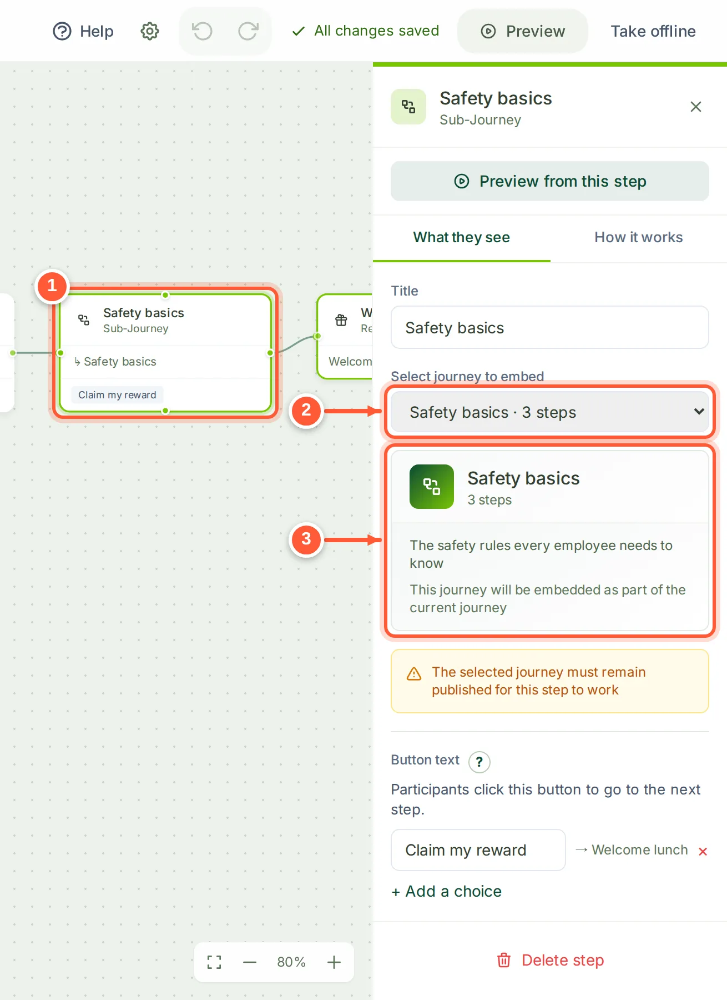

# Sub-Journey Step

The Sub-Journey Step puts a complete published journey inside another journey. Use it to reuse content and to keep large journeys easy to manage.

1. The Sub-Journey step on the canvas.
2. Select journey to embed: choose a published journey.
3. The embedded journey with its number of steps. It must stay published.

## Adding a Sub-Journey Step

In the column of step types on the left side of the builder, click **Sub-Journey** to add a Sub-Journey Step (1) to your canvas.

## Overview

With Sub-Journey Steps you can:

- **Split content**: break a large journey into smaller journeys
- **Reuse content**: use the same journey in several other journeys
- **Keep the canvas clear**: put a long section in its own journey
- **Use another language**: a sub-journey can have its own language

## Properties

### What they see

| Property | Description |
|----------|-------------|
| **Title** | The title of this step (for makers only) |
| **Select journey to embed** | Choose which published journey to show in this step |

### Choosing the sub-journey

Choose the journey in **Select journey to embed** (2). Only **published** journeys of your organization can be chosen. Each option shows:

- The journey title
- The language, when the journey uses a different language than your organization
- The number of steps

Below the dropdown, the selected journey (3) is shown with its cover image, number of steps and the start of its description. It must stay published.

### How it works

On the **How it works** tab you can add a **Guide in this step**.

See: step-assistant

## How It Works for participants

1. The participant reaches the Sub-Journey Step.
2. They go straight into the selected sub-journey.
3. The language switches if the sub-journey uses a different language.
4. The participant completes all steps in the sub-journey.
5. When the sub-journey is done, they return to the parent journey.
6. The journey continues with the next step after the Sub-Journey Step.

**Note**: Participants experience this as one journey. They see no extra screen or message when they enter or leave a sub-journey.

## Progress Tracking

"Step X of Y" above each step counts the steps of the parent journey and the sub-journey together. Participants see how far they are in the whole journey.

## Restrictions

### For public journeys

Public journeys can **only** use sub-journeys that are:
- Published
- Also public

This keeps private information out of a public journey. For the same reason, you cannot make a journey public while it uses private sub-journeys. Make those sub-journeys public first, or remove them.

### For private journeys

Private journeys can use any published journey as a sub-journey, public or private. The parent journey is private, so all content stays protected.

### Protected sub-journeys

When a journey is used as a sub-journey, some actions are blocked:

| Action | Allowed? |
|--------|----------|
| **Take offline** | No, while a published journey uses it. Remove it from that journey first. |
| **Move to Trash** | No, while another journey uses it. Remove it from that journey first. A published journey must also be taken offline first. |
| **Make private** | No, while a public journey uses it. Remove it from that journey first, or make that journey private. |
| **Edit content** | Yes. Changes show in the parent journey right away. |

This makes sure participants never end up in a broken journey.

## Tips

### When to use sub-journeys

- **Onboarding modules**: company policies, IT setup and team introductions as separate journeys
- **Certification paths**: required modules as sub-journeys before the main part
- **Multi-language content**: the same structure, with a sub-journey per language
- **Changing content**: put content that changes often in a sub-journey, so you can swap it easily

### Design tips

- Keep each sub-journey on one topic.
- Think about the combined length. Too many steps can overwhelm participants.
- Test the full journey, including all sub-journeys.
- Keep track of which journeys use which sub-journeys.

## Circular Reference Prevention

Gryffi prevents journeys from using each other in a loop. For example:

- Journey A cannot use Journey B as a sub-journey if Journey B already uses Journey A.
- This check works through any number of levels.

## Related Features

- [[goto:/dashboard/journeys]] - Create and manage journeys
- See: journey-builder, journey-settings, public-journeys
