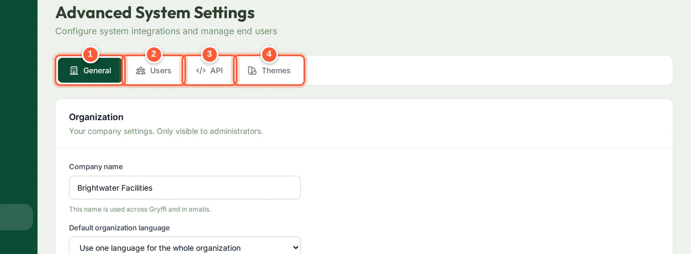

# System Settings

System Settings provide advanced configuration options for your Gryffi organization, including general organization settings, End user management and synchronisation, Gryffi API for automating end user management, Custom Themes

1. General: the settings of your organization.
2. Users: end users and groups, and the sync with Microsoft 365 or Google Workspace.
3. API: the key for the public API.
4. Themes: the look of your journeys.

## Overview

System settings include:

- General Organization settings
- End User management
- API settings and examples
- Custom Theme builder

[[goto:/dashboard/system-settings]]

## General

On the **General** tab (1) you set:

- Company name: The name of the organization for everyone in your organization
- Default organization language: The organization default language that is used in the journey interface and company automated emails
- Country: Useful for currency and dates

## Users
On the **Users** tab (2) you create and manage end users:
- Manual Entry
- CSV/Excel Import
- Microsoft 365: Sync with Azure AD
- Google Workspace: Sync with Google Directory

## Integration Settings

### API Configuration

Use the API to integrate Gryffi with your automation workflows. Generate an API key on the **API** tab (3) to get started.

See: api-access

### Directory Sync

| Provider | Settings |
|----------|----------|
| Microsoft 365 | Connection, sync schedule |
| Google Workspace | Connection, sync options |

See: microsoft-365-sync, google-workspace-sync

## Themes

On the **Themes** tab (4) you create custom themes for your organization to use in Journeys, emails and PDFs.

## Related Features

- [[goto:/dashboard/settings]] - All settings
- See: organization-settings, api-access
