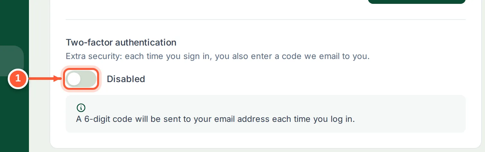

# Two-Factor Authentication (2FA)

Two-factor authentication adds an extra check when you sign in. After your password, you also enter a code that Gryffi sends to your email address.

1. Turn it on: after your password, Gryffi asks for a 6-digit code that is sent to your email address.

## Overview

2FA asks for two things:

1. Something you know: your password.
2. Something you have: your email inbox.

Someone who knows your password still cannot sign in without the code.

## Enabling 2FA

### Step 1: Go to My account
Click My account in the menu.

[[goto:/dashboard/settings]]

### Step 2: Turn on Two-factor authentication
1. Find **Two-factor authentication** in the Security section.
2. Turn on the switch (1). It now shows **Enabled**.
3. From now on, every time you sign in, Gryffi sends a 6-digit code to your email address.

To turn it off, turn off the same switch.

## Logging In with 2FA

1. Enter your email address and password.
2. Click **Sign in**.
3. Enter the 6-digit code from your email.
4. Click **Verify**.

The code works for 10 minutes. No email? Check your spam folder, or click **Resend code**. You can ask for a new code 3 times. After 5 wrong codes, you go back to the login page and enter your password again.

## Related Features

- [[goto:/dashboard/settings]] - My account
- See: authentication, login, user-settings
