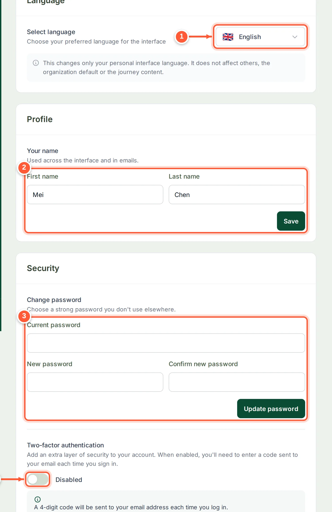

# My account

My account has your personal settings: your language, your name, your password and two-factor authentication.

1. The language of the interface, for you only.
2. Your name as it appears in Gryffi and in emails.
3. Change your password.
4. Turn two-factor authentication on or off.

## Overview

My account includes:

- Your interface language
- First name and last name
- Change password
- Two-factor authentication
- Contact Support

[[goto:/dashboard/settings]]

## Profile

| Field | Description |
|-------|-------------|
| **First name** (2) | Your first name |
| **Last name** | Your last name |

Click **Save** to keep the changes.

## Change password

1. Go to My account.
2. Scroll to the Security section.
3. Enter your current password (3).
4. Enter the new password twice.
5. Click **Update password**.

A password has at least 8 characters. Your other devices are signed out within a minute.

See: password-management

## Two-factor authentication

1. Go to My account.
2. Find **Two-factor authentication** in the Security section.
3. Turn on the switch (4).

From now on, Gryffi sends a 6-digit code to your email address each time you sign in.

See: two-factor-authentication

## Language

Choose your interface language (1):
- English
- Nederlands (Dutch)
- Deutsch (German)
- Français (French)
- Español (Spanish)

This changes only your own interface. It does not change the language for others, the organization default or the content of journeys.

See: language-settings

## Contact Support

Click **Contact Support** to report a bug or ask a question. In the Community Edition, this opens the Gryffi discussions on GitHub in a new tab.

## Best Practices

- Keep your name up to date.
- Turn on two-factor authentication.
- Use a strong password that you do not use elsewhere.

## Related Features

- [[goto:/dashboard/settings]] - My account
- See: password-management, two-factor-authentication, language-settings
